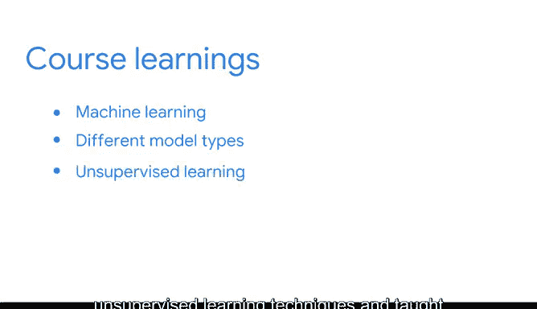

# 谷歌高阶数据分析 7：《谷歌高级数据分析项目》google-advanced-data-analytics-capstone（中英双字） - P16：16_03_04_探索职业发展机会.zh_en - GPT中英字幕课程资源 - BV1qV4y1t7kk

You just earned your Google career certificate。 This is a huge achievement that demonstrates that you are invested in learning new skills for your future。

On behalf of my fellow course instructors and myself， congratulations。

Now that you have earned your certificate， you can share your accomplishments during your job search。

It can be displayed on job search platforms such as LinkedIn， Indeed and Glasdoor。

You can also connect with companies in your field that are eager to hire through Grow with Google's  employer Consortium。

As you learned at the beginning of this program， the demand for data skills is growing at an incredible rate。

With the skills and knowledge you've gained from this program。

 you can begin applying for jobs or work to advance your career in this high growth。

 high impact field。The process may take some time。But you now have everything you need to get hired in the data career space。

 Let's review all you've learned throughout this program。

You started by learning the foundations of data science here。

 you learn the roles and functions that data professionals play within an organization。

Then you learned about the data tools and the importance of a structured workflow。 As a reminder。

 effective communication is crucial for successful collaboration as a data professional。 And finally。

 you learned about careers in data driven fields and how to prepare yourself for your future。

In the next course， you learned how to use Python for data related work。

 You investigated a variety of concepts within the Python language， such as syntax， variables， loops。

 strings， data structures， and object oriented programming。Additionally。

 you discovered how to expand Python's capabilities with libraries and packages。Next。

 you explored how to access stories within data through exploratory data analysis here you used more tools within Python to clean and prepare data for analysis。

 you also learned how to create visualizations using Tableau that help present information inside of large data sets。

In your statistics course， you learned about descriptive and inferential statistics。

Basic probability and probability distributions， sampling。

 confidence intervals and hypothesis testing。 You had the opportunity to conduct A V testing。

 using actual data。Then you investigated regression models and learned about assumptions， validation。

 construction， evaluation and interpretation。Each of these were explored using Python and incorporated into your PaE workflow。

Finally， in the last course， you focused on the machine learning landscape。

  building on your knowledge of machine learning。 you explore different types of models like supervised。

 continuous and categorical。You were also introduced to unsupervised learning techniques and taught how to use them to meet business needs。

It was an incredible amount of work As you enter this new phase in your career。

 be sure to stay engaged by following trends within the data career space。

 Your learning journey doesn't end here。 You can keep it up to date with industry news。

 emerging data insights and inventive ways to improve your skills。 Also。

 continue updating your portfolio and resume to highlight your best work and what you've accomplished。

😊，You've already shown some serious dedication to the field。 So stay curious。 And with that。

 congratulations， It's been wonderful leading you through the final part of this program。

 I know you're well prepared for a fantastic career， as a data professional。😊，Good luck。😊。

