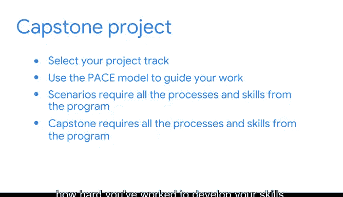

# 谷歌高阶数据分析 7：《谷歌高级数据分析项目》google-advanced-data-analytics-capstone（中英双字） - P1：01_01_01_课程7介绍.zh_en - GPT中英字幕课程资源 - BV1qV4y1t7kk

Hey there。Throughout this program， you've been developing your skills as a data professional and practicing effective communication。

 Additionally， you've been building a portfolio of examples to showcase your abilities。😊。

And after all of your dedication and hard work， you've reached the capstone。

 the final project of this program， congratulations。😊。

At the conclusion of each of the earlier courses， you completed a portfolio project。In each。

 you practice the skills you learned in that course within those portfolio projects。

 you used a pace strategy document。There， you outline your goals and plan the necessary workflow to perform each task。

As a result， you've already created a number of great examples for your portfolio that are similar to the projects you will complete as a data professional。

Each project highlights your ability to perform specialized tasks that relied on specific skills and tools。

In this capstone course， you'll begin by selecting one of the project options and reading through the project overview。

Next， you will use the pace model to guide your workflow。

 These capstone scenarios will bring together all of the content and skills you have applied in each of the past portfolio projects。

 The big difference is that instead of focusing on individual course topics。

 the capstone project will incorporate all of the skills you developed in this program from start to finish。

By adding your capstone project to your portfolio， employers and business contacts will recognize what you have accomplished and how hard you've worked to develop your skills。

As you begin this project， know that you can go at your own pace。

 You can always refer to your past work if you face a challenge or need help。

Each lesson and activity in this program has helped you prepare for the steps you'll complete in this project。

Now it's time to begin the capstone project。Good luck。 Let's get started。

