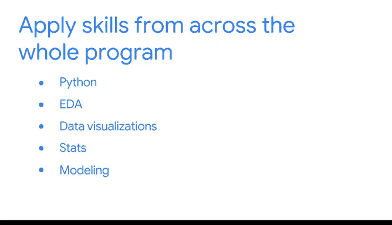

# 谷歌高阶数据分析 7：《谷歌高级数据分析项目》google-advanced-data-analytics-capstone（中英双字） - P2：02_01_04_顶点项目内容概览.zh_en - GPT中英字幕课程资源 - BV1qV4y1t7kk

Welcome back。 Let's talk about what to expect in the capstone project。At this point。

 you've had a chance to review the project details and the different project options Shortly。

 you have an opportunity to access the instructions and review an example for the capstone project。

Once you have reviewed the instructions， you'll start by selecting one of the project options here you will be given access to all the necessary data and project information。

Next。Use the pace model to organize your approach and outline the necessary steps you will need to take。

The capstone project follows a similar structure to each of the portfolio projects。

By this point in the program， none of the tasks needed to complete the capstone will be new to you。

 And if you get stuck， you can review previous projects。

There is one major difference between the capstone project and the portfolio projects you've done so far。

The capstone Project is comprehensive because it requires skills and knowledge developed across the whole program。

 including Python， EDA。Data visualizations， stats， modeling and pace。

Now it's time to get started。At the end of the project。

 you'll have a set of artifacts that you can add to your portfolio to showcase your skills to prospective employers。

 Good luck on your capstone。

