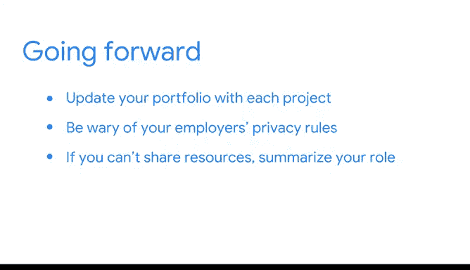

# 谷歌高阶数据分析 7：《谷歌高级数据分析项目》google-advanced-data-analytics-capstone（中英双字） - P3：03_01_01_将项目成果融入数据分析作品集.zh_en - GPT中英字幕课程资源 - BV1qV4y1t7kk

If you've earned your Google data analytics certificate or completed any data projects in general。

 you may already have an online portfolio。 As a reminder。

 our portfolio is a collection of materials that can be shared with potential employers。

 It's a part of your job application with evidence of your accomplishments。

 If you don't have a portfolio yet。 it's time to make one。 A portfolio is a shareable。

 accessible way to showcase your work。 Poent employers will be interested in the skills you've gained through this program and other skills you may have through previous experiences。

Having tangible artifacts in a portfolio to demonstrate these skills for prospective employers should set you up well for the interview process。

 You can also use it to demonstrate your background in non data industries。

 So it's important to create a well rounded portfolio。

 Portfos enable you to share pace model documents。 Gitthub repositories。

 Link to presentation slide decks and other assets that will help demonstrate your skills。

You can host your portfolio on your own custom website or use an existing data sharing platform。

 Ss like Gitthub or Cagle that you may have used for sharing data can be used to link out to your project artifacts。

 Tableau also has a social platform and sharing capabilities。

Once you pick a platform or multiple platforms to host your portfolio， you can add your projects。

 Choose whether to represent your projects by including your data， screenshot of your visualizations。

 embedding the code or all of the above。If embedding isn't possible on the platform you choose。

 you can always include links to allow access to your projects When you've included all of the relevant parts from your project and your portfolio。

 you should also explain your process De what work you did why you made the choice and what you could have done differently。

 It also helps to include a short biography by describing your professional goals and interests。

 you can personalize your portfolio and make it stand out against other applicants。 going forward。

 it's important to update your portfolio as you complete projects through educational experiences。

 online courses or on the job。 Some projects you work on may deal with private data。

 So make sure that you follow your employer's rules and regulations for data sharing。

 in cases where you cannot share any data or visuals from a project。

 you can still include a summary of what you did in your portfolio。

 which details you share may be determined by your employer。

 but it's important to document the roles you had on each project you were a part of。

Now it's time to create or update your portfolio。 You can do this now or make time to update your portfolio later。

 This will be a process you go through periodically throughout your career。

 demonstratingating your accomplishments in a portfolio will get you ready for new opportunities now and for years to come。

