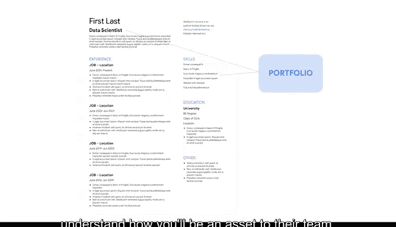

# 谷歌高阶数据分析 7：《谷歌高级数据分析项目》google-advanced-data-analytics-capstone（中英双字） - P4：04_01_03_优化你的简历.zh_en - GPT中英字幕课程资源 - BV1qV4y1t7kk

Earlier in the course， you learned about creating a portfolio before you apply for a job。

 it's also important that you prepare a resume。 A good resume can directly impact your chances of becoming a candidate for a position。

If you completed the Google Data Analytics program。

 you learned a lot about creating an effective resume。If you need a refresher。

 feel free to revisit those resources。As you transition into your job search。

 you want to review your resume to ensure it reflects the experiences， technical abilities。

 knowledge and skills you've developed in this program。

 Let's discuss what organizations expect in a data professionals resume and what you can do to help your stand out。

There are often a wide varieties of responsibilities listed in job descriptions。

 so one of the first things you can do to improve your chances of getting noticed by recruiters and hiring managers is to refocus your resume for the specific job you are applying for。

To do this， look over the requirements for the position and take note of areas within your resume that showcase the skills listed on the job posting。

 You may need to revise descriptions on your resume so that they reflect language and terms used in the job posting。

 Since many of the jobs in the data career field are specialized。 your resume should be as well。

Most employers expect a resume to include technical and software proficiencies。

This is where you'll list the languages， platforms and software that you have used to analyze data。

 After completing this program， I encourage you to add Python and Tableau。As you revise your resume。

 you can also include previous work and educational experiences you have with other data related software。

It might be the case that you encounter job descriptions listing programming languages。

 software and skills you are less familiar with。 In those instances。

 consider which tools and skills you have on your existing resume that may be transferable to the position you're applying for in this program you learned many valuable skills that transfer across roles in the data space。

 Don't forget to list your newly developed skills， including E， statistics。

 modeling and communication。Keep in mind that hiring managers want to see examples of past work。

 As we discussed previously in the program， this is most often demonstrated through an online resume or a portfolio。

Portfolios and resumes work together to help potential employers and hiring managers better understand how you'll be an asset to their team because of your hard work throughout this program。

 you've created a portfolio full of pace strategy entries and data projects。

All of these are strong evidence of your proficiency as a data professional。

There may even be places in your resume， where you can briefly describe what you've learned in the program。

As you begin the process of applying for positions。

 take time to revise and update your resume with your completed portfolio and resume。

 you'll be ready to move into the final part of the application process。Interviews。

