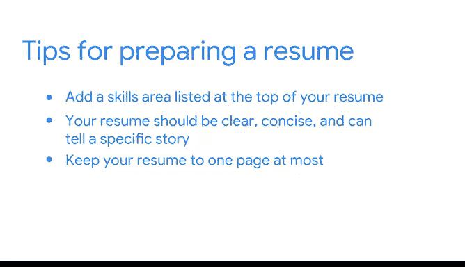

# 谷歌高阶数据分析 7：《谷歌高级数据分析项目》google-advanced-data-analytics-capstone（中英双字） - P5：05_01_04_Daniel：打造一份引人注目的简历.zh_en - GPT中英字幕课程资源 - BV1qV4y1t7kk

My name is Daniel and I am a technical recruiter on our product analyst and data science teams。

 I feel like helping candidates you know land an amazing job is really kind of a lifechanging experience and so being a part of that journey is really amazing。

 I probably reviewed thousands and thousands of resumes during my career at Google so hopefully during this conversation I can give you some tips and tricks to kind of stand out amongst the crowd as an entry levelvel person entering into the data analytics field for the first time there's a number of different things you can do to your resume to make you stand out amongst the crowd So the first thing you want to do is make sure that your skills area is listed at the top of your resume and calling out in that skills section。

 what is relevant to the role that you're applying to so for data analytics the things that we're really gonna look for is areas like statistics some coding language software analytics frameworks so being able to call that out in the top of your resume is really important but you also want to call up the soft skills and I think that can be really relevant。

Through a number of different areas， so in your past work， it could be things like collaborating。

 working cross functionally， being able to problem solve。

 The second piece is you want to make sure that your resume is very clear and concise and can tell a specific story。

😊，In the experiences， it doesn't have to be specific work experience。

 it could be projects you've worked on at school， it could be internships。

 but you really want to call out anything that aligns to you know solving analytics problems。

 using metrics， and really solving problems， using using these analytic frameworks。

And then the last piece I'll say is keep it to one page at most and make sure that in your experience that it's in reverse chronological order and you're really telling a story about what you've done in analytics。

 If you're looking to come into a field and you don't have experience。

 There's a lot of your past experiences could be really relevant to what they're looking for。

 So the first thing I'd recommend would be to look at the postings。

 look at the analytical field and see what are the key areas that they typically look for and then look through your past experience and see how that aligns。

 a lot of what we look for， aside from like those core kind of hard technical skills and data science is really about how you're able to break down problems。

 apply some analytical method and then provide recommendations and work with the business。

 And say think a lot of times you can pull that from your past experience。

 and it's very relevant to what we do here。 just a little bit different maybe in analytics。😊。

