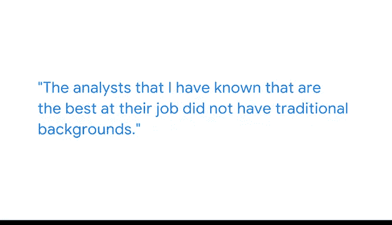

# 谷歌高阶数据分析 7：《谷歌高级数据分析项目》google-advanced-data-analytics-capstone（中英双字） - P6：06_01_05_Eva：数据职业生涯的起点无处不在.zh_en - GPT中英字幕课程资源 - BV1qV4y1t7kk

Hi， I'm Eva。 I'm a product analytics lead here at Google。 I manage a team of analysts。

 and together we help our product managers and our engineering partners answer business questions so that they can help advertisers better optimize their accounts on Google adss。

 So I started off doing mostly， I would say sales， marketing and event planning sorts of jobs。

 I kind of just said yes to everything and anything that my friends were involved in。

 And all of this combination of different backgrounds and jobs。

 ultimately taught me how to tell stories。 And I thought that was really important。

 when I first joined Google。 I was actually a salesperson。

 So I helped people optimize their Addwords accounts。 while I was doing that。

 I realized that I wanted to do a better job myself to help people more effectively and at scale and all of these sorts of things。

 So I would you know after work， go home， watch a bunch of YouTube videos on how to do SQL。

 met with some analysts and partner teams we went through like a few SQL problems。😊。

I started teaching other people how to do that in doing that。

 I made friends with some people on the sales analytics side of things。 and they took a chance on me。

 to be honest and eventually transitioned to an analytics team。 I think that， you know。

 having that deep knowledge of the sales program and then switching to a team that was focused on helping the salespe helped because then I had that deep context。

 The analysts that I have known that are the best at their job did not have traditional backgrounds。

 I think that the people that I look up to the most were cellists。😊。

Drummers， biologists， physicists， teachers， etc cetera。

 And the reason why you're in a particularly great position， not having the traditional job。

 but learning the skills now is that no analyst is worth their salt。

 If they do not have the business context， deep understanding of the people that they're working with in order to be able to help them answer their questions。

 You， by not being in that traditional world， have that knowledge。 So don't feel like， oh， no。

 you're so behind or anything like that。 understand that you coming from a nontraditional background actually has quite a bit of value。

