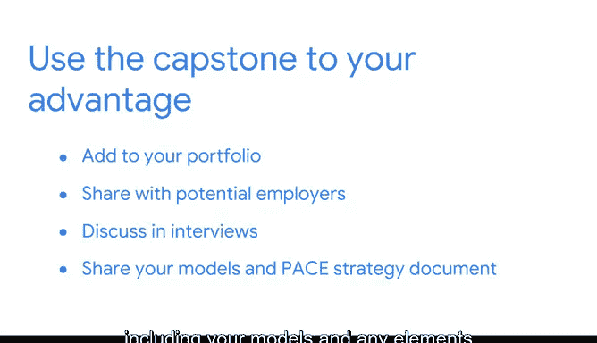

# 谷歌高阶数据分析 7：《谷歌高级数据分析项目》google-advanced-data-analytics-capstone（中英双字） - P7：07_01_01_顶点项目总结与持续职业成功建议.zh_en - GPT中英字幕课程资源 - BV1qV4y1t7kk

Congratulations， you completed the capstone project。

 This is a huge accomplishment that demonstrates all your hard work in this course。

 You apply to your knowledge of data science and effective communication。

 creating a dynamic representation of your professional skills。

 You can now include the capstone project in your portfolio。

 Share it with potential employers and discuss it during interviews。😊。

You can also share any of the materials you generated during the process。

 including your models and any elements of your pay strategy document。

These can help explain your workflow， thought processes， and ultimately the choices you made。 Idely。

 you'll share all of the above。Each component illustrates a step in your progression as a data professional。

 Let me be the first to congratulate you on completing the capstone project。

 Your commitment to this program has been impressive。

 and I can't wait to have you share your passion for data science with prospective employers。

 Before that， we're going to get you ready for the job market。😊，First。

 well refine your resume and prepare you for the interview process。

 Then before you leave the program， we'll take a moment to celebrate your incredible accomplishment。

😊。

