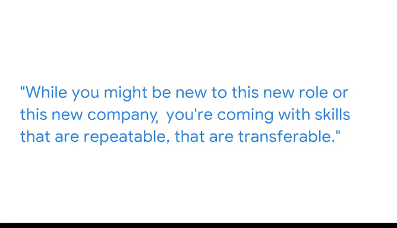

# 谷歌高阶数据分析1：《数据科学基础》foundations-of-data-science（中英双字） - P10：10_02_02_Adrian打造数据驱动的业务解决方案.zh_en - GPT中英字幕课程资源 - BV1px4y1d7Mj

As going， my name is Adrian and I'm a customer engineer at Google。

 A customer engineer at Google is the bridge between the technical and business components or aspects of corporate America。

 We help customers leverage our technology to meet their business needs。

One of the most exciting projects and even interesting that I worked on was creating a unified patient record。

 And this project was for a lab diagnostics company that was really looking。😊。

Into creating a 360 view of a patient， our project focused on consolidating information across different systems。

 You can imagine taking your lab diagnostics data for your most recent routine blood work or even something that's a little bit more specific。

 You know， a diabetes or luan test， taking that in all the information that you've provided in terms of biological data。

Getting that centralized and standardized in one environment so that if it is your physician looking at the data or your radiologist or you're your nutritionist。

 they have a complete view of all of your data and they can not only just access it。

 but they can visualize it in real time。 One of the key components of this project was the use of virtual reality headsets as the main visualization component For me。

 what this meant was I got the ability to do some game design。

 create some human skins in terms of the body and use different colors and programming functionality to indicate。

 for example， the system is looking healthy or if it's looking like it needs concern or intervention。

 we can see over time how the diagnostic test results have changed and the impact that this has on our patients At the end of the day。

 what we had was a project that unified all of the data for the patient。

And gave the key medical professionals a way to visualize it。

 The best piece of advice that I have for you is to remain confident in yourself While you might be new to this new role or this new company。

 you're coming with skills that are repeatable that are transferable。

 whether it be the way that you approach and problem solve。

 whether it be the rapport you're able to build with your stakeholders and the soft skills and ensuring that you can build those relationships。

Or even when it comes to communication and writing a succinct， concise email。

 there are gonna be ways where you're gonna take what you've done before and apply them in your new role。

 You might have to think outside of the box， but you'll get there。

