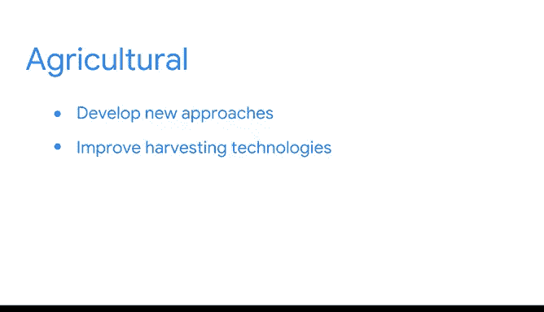

# 谷歌高阶数据分析1：《数据科学基础》foundations-of-data-science（中英双字） - P11：11_02_03_数据驱动型职业推动现代商业.zh_en - GPT中英字幕课程资源 - BV1px4y1d7Mj

Data professionals are so valuable to their companies。

 They determine which data streams are most important to specific business projects。

 challenges and initiatives。 They identify key goals for the future。

 and they give their organizations the ability to take meaningful action by reimagining processes and improving operations。

😊，To do all of this， data teams require individuals with diverse skills， knowledge and interests。

Therefore， there are countless different data focused roles， responsibilities and project types。

Which are further differentiated by the industries and businesses they support。

Among all of these possibilities， data careers can be loosely categorized into two complementary types of work technical and strategic in this video we'll investigate both We'll also consider some examples of how data professionals use their expertise to transform industries。

 First， let's find out about the folks whose work requires a heavy emphasis on technical skills。

 Some examples of these professionals are machine learning engineers and statisticians。😊。

Through their expertise in mathematics， statistics and computing。

 they build models and make predictions using tools such as R and Python。

 They help their teams extract value from business data sets。

 The result is a solution that has a direct， positive impact。😊。

Another highly technical role is the expert data analyst whose work involves exploring vast and complex data sets to identify directions worth pursuing in the first place。

😊，They ensure that an organization's data science efforts are directed as efficiently as possible。

 bridging the gap between other technical data professionals and the strategic work well cover shortly。

Okay， now let's consider data professionals on the more strategic side。

These people include business intelligence professionals and technical project managers to name a couple。

Strategic data professionals use their skills to interpret information that affects an organization's operations。

 finance， research and development， and so much more。

 their work aligns closely to the overall business strategy and involve seeking solutions to problems through data analytics。

 In short， strategic data professionals maximize information to guide how a business works。

 Sometimes you'll find a company has roles that blend specialist technical knowledge with strategic data expertise。

 often in unusual and very creative ways。 So we'll learn more about some of these opportunities。

 as well as the more specialized technical and strategic roles。 Now。

 let's consider some examples of how data professionals use their expertise to transform industries such as finance。

 health care， manufacturing and agriculture。 First。

 the world of big finance was an early adopter of the power of data science。😊。

And with the way information drives this industry， it's easy to understand why data professionals help financial institutions assess investment risks。

 monitor market trends， detect anomalies to reduce fraud and create a more stable financial system Overall。

 Data analytics is also key in healthcare care。 And here。

 the data benefits can actually be in life saving。 Data analytics is helping health care organizations。

 process large amounts of clinical data， which supports the early detection of a health condition and leads to more precise diagnoses。

 Thirdly， data has a big impact in manufacturing。 Data professionals predict when to perform preventative maintenance to avoid production line breakdowns。

 Use data to maximize quality assurance and defect tracking。

And artificial intelligence models help respond to logistical issues and reduce delivery truck miles on the road。

 advancing key sustainability goals。And in a time when supply chains reach every corner of the world。

 data enables clear and near real time communication with suppliers。

 retailers and other network partners。 Data professionals are also advancing approaches to agriculture。

 with data insights。 farmers develop new ways to approach crop production， livestock care。

 forestry and aquaculture。😊，The inclusion of autonomous machinery。

 tractors and irrigation systems is improving harvesting technologies as well。

If you'd like to keep learning about how various industries use data analytics。

 refer to the course resources on this topic。And here's a little piece of advice for me。

Don't miss an opportunity to learn from someone in real life。 I love asking business owners。

 store managers and client support professionals about how they use data each and every day。

 Who knows one of these conversations could open a door to a future opportunity for you。😊。

