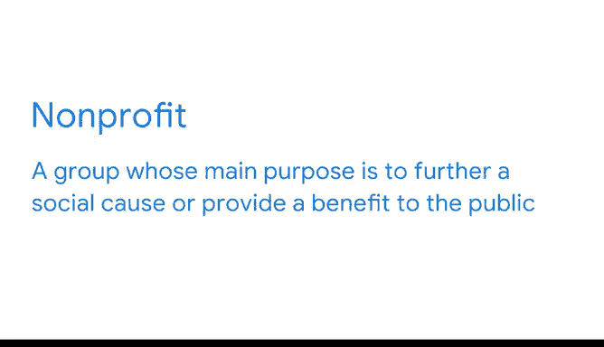
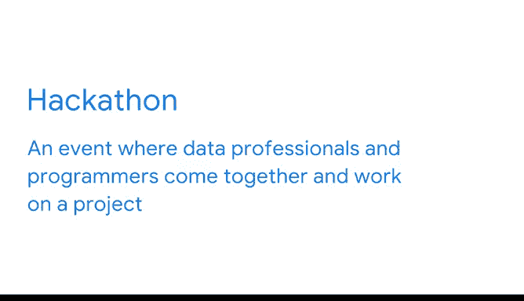

# 谷歌高阶数据分析1：《数据科学基础》foundations-of-data-science（中英双字） - P12：12_02_06_在非营利组织中运用数据分析.zh_en - GPT中英字幕课程资源 - BV1px4y1d7Mj

Recently， you've been learning about how businesses use data to guide decision making。

 answer questions and solve problems。 In this video。

 we'll investigate how nonprofits use data analysis to pursue their unique goals。😊。

Nonprofit groups are created to further a social cause or provide benefit to the public。

 As the name suggests， their main purpose is not about profit， but to foster a collective。

 public or social advantage。 There are some very rewarding and inspiring opportunities for data professionals in the nonprofit sector。

😊。

In particular， data can be applied in order to help these groups more effectively anticipate and respond to the greatest areas of need。

😊，For instance。Maybe a US charity that provides bicycles for children would like to determine which neighborhoods are most in need。

 They could ask their data professional to access the US Census Bureau。

The professional would use their talents to navigate the census database， identify key metrics。

 and summarize findings with analyses and data visualizations。

This report would highlight where there are larger numbers of school aged children in need who would benefit from the resources of this program。

And there you go， data insights led to informed decisions about where this nonprofit can do the most good。

Now， nonprofits do more than use data。 Many of them also collect it。 As you likely know。

 public entities and government agencies can be excellent resources for useful data。

 and much of it is open data that's available for general use。As you likely know。

 open data is data that is available to the public。

It's free to use and guidance is provided to help navigate the data sets and acknowledge the source。

While sourcing open data is a good way to interact with data on your own。

 there are other opportunities that enable you to refine your skills while helping others。

 Data volunteers contribute to many projects that help nonprofits benefit Commun all over the world To find out more。

 Here are some organizations to check out First， the data science for Social Good Foundation was launched at the University of Chicago back in 2013 In 2020。

 they trained forces with UNICEefF to analyze various aspects of air pollution around the world to help monitor children's health。

 Datakind launched in 2011 in New York City with chapters in the United Kingdom， Benalluru。

 San Francisco， Singapore and Washington， D。 C。 This organization analyzes the cost of En cleanup in different underserved Commun to guide restorative efforts。

😊，You can view both foundation's latest efforts through the links in the transcript for this video Another option for putting your data skills to good use are hackathons a hackathon is an event where data professionals and programmers come together and collaborate on a particular project。

😊。

The goal is to create a solution to an existing problem using technology。

 Some examples include developing better tools for predicting extreme weather events。

 creating tech to help elementary school kids learn important reading skills and identifying ways that community development groups can use their data to advance home accessibility and affordability。

😊，Volunteering your data skills to public projects is an excellent way to contribute to the greater good while gaining experience and networking with others in your field。

Coming up， we'll take a deeper look at some data oriented projects in the public sector and how they're making an impact around the world。

