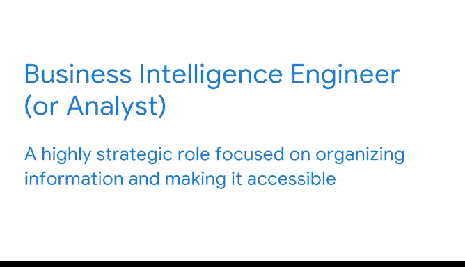

# 谷歌高阶数据分析1：《数据科学基础》foundations-of-data-science（中英双字） - P15：15_02_01_数据专业人员的职业领域.zh_en - GPT中英字幕课程资源 - BV1px4y1d7Mj

You can learn a lot about a career by looking at job postings。

If you've searched for opportunities in the data space。

 you may have noticed different data related job titles with similar responsibilities or postings with similar titles listing different responsibilities。

 Here's an example。 At one company the role of data analyst will focus on using statistics and models to craft insights that inform business decisions。

 Another job with the same title at a different company may focus on optimizing the tools and products that automate analytical processes。

 One reason for these inconsistencies is that data tasks and responsibilities are dependent on an organization's data。

 team structure and how they make use of insights and analytics。

 Some organizations choose to be very specific with responsibilities。

 Others leave job tasks quite broad in scope。 That's why this program refers to the field as a career space In this video will explore key roles in the data analytics career space。

😊，Two of the most common titles are data analyst and data scientist。

 These can cover a wide range of job responsibilities。

 many of which you'll gain experience with in this program。Traditionally。

 a data scientist was expected to be a three in one expert in data analytics。

 statistics and machine learning， but not all employers use these conventions when writing their job descriptions。

 generally any role that includes analytics expects candidates to be able to function as technically skilled social scientists looking for patterns and identifying trends within big data sets。

 Also， they develop new inquiries and questions as they uncover the stories inside their data。

 Their hard work can help steer accompies future actions and guide decision making They allow their organizations to keep a finger on the pulse of what's going on in the business。

 interpreting and translating key information into visualizations such as graphs and charts。

 allowing every stakeholder to understand their findings at times。

 they may be tasked with creating computer code and models to recognize patterns in the data and make predictions。

 when you investigate job postings you'll。😊，Counter other titles with similar responsibilities。

 For example， junior data scientist， Data scientist entry level。

 associate data scientist or data science associate。

 All of these roles include a mix of technical and strategic skills to help others make informed decisions。

 With that said， when you're comparing positions that have similar titles。

 I encourage you to classify them based on the skills used in their day to day activities。

In your career， you might encounter other professionals in roles that use data and analytical skills these roles include data engineer。

 Inss manager or analytics team manager and business intelligence engineer or analyst data scientists depend on systems within their companies to collect。

 organize and convert raw data Designing and maintaining these processes are some of the most important responsibilities of a data engineer。

Their goal is to make data accessible so that it can be used for analysis。

They also ensure that the company's data ecosystem is healthy and produces reliable results。

These positions are highly technical and typically deal with the infrastructure for data。

 usually across an entire enterprise。 you also need to have the ability to get data before it even makes sense to talk about data analysis。

 Most of the technical work leading up to the birthing of the data may comfortably be called data engineering。

 and everything done once some data have arrived I data science。

 similar to how a data engineer oversees the data infrastructure。

 there are data roles that manage all aspects of data analytics projects for a company In science managers or analytics team managers often supervise the analytical strategy of the team or if the organization as a whole。

 As a data analyst， you will likely report to someone working in this capacity。

 They are often responsible for managing multiple groups of customers and stakeholders。

 and they are often a hybrid between the data scientist and the decision maker Since this combination of skills is rare。

 These positions are often more difficult to fill this role can。

Have other titles like analytics team director， head of data or data science director。

 Other common job postings include business intelligence engineer or business analyst。

 This role is highly strategic， focused on organizing information and making it accessible BI analysts synthesize data。

 build dashboards and prepare reports to address specific needs for a business or requests from leadership。

If you're interested in learning more about business intelligence and its opportunities。

 I encourage you to look into the Google Business Intelligence Cer now that you have some idea of the roles found within the data analytics career space。

 we will begin to take a closer look at how data professionals function within their larger organizations。

