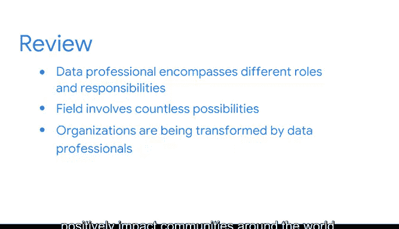

# 谷歌高阶数据分析1：《数据科学基础》foundations-of-data-science（中英双字） - P16：16_02_01_总结_2.zh_en - GPT中英字幕课程资源 - BV1px4y1d7Mj

In this section of the course， we explored many different facets of data careers。

You learned that data professional is a broad term that encompasses different roles and responsibilities in the data space。

You discovered that the work we do in this field involves countless possibilities。

 such as determining important data streams， identifying and focusing on future business goals and reimagining internal and external processes。

 You also thought about some of the ways that organizations are being transformed by data professionals and how these talented individuals use their skills to positively impact communities around the world。

😊。

You've come so far already， but there is so much more to learn。

Thanks for joining me on this exciting exploration， and I'll catch up with you again soon。😊。

