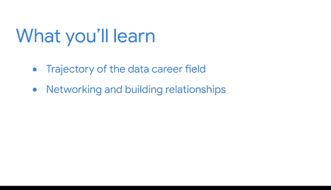

# 谷歌高阶数据分析1：《数据科学基础》foundations-of-data-science（中英双字） - P17：17_03_01_欢迎来到模块3.zh_en - GPT中英字幕课程资源 - BV1px4y1d7Mj

Welcome back。 I'm really excited to share this section with you。

 We'll investigate where data careers are headed in the future， including new and exciting tools。

 It's such an impactful and rewarding field， And it just keeps getting better。

 Then we'll explore the importance of networking and building relationships within an organization。😊。

So let's get started。 See you in the next video。