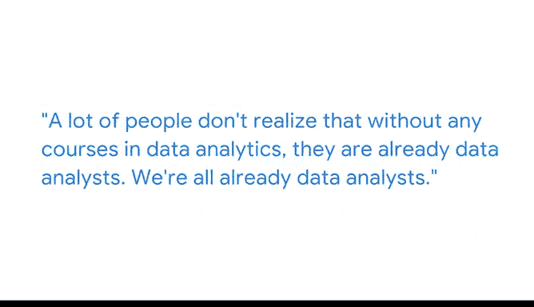

# 谷歌高阶数据分析1：《数据科学基础》foundations-of-data-science（中英双字） - P18：18_03_02_Cassie对数据的毕生热爱.zh_en - GPT中英字幕课程资源 - BV1px4y1d7Mj

Hi， I'm Cassie and I serve as chief decision scientist at Google Cloud。

 the very first time that I fell in love with data I was eight。

 maybe nine years old and I discovered Microsoft Excel and I fell in love with it which is an unusual thing。

 most kids are out there climbing trees and here I am playing with Excel and I had this gemstone collection。

And I would love putting the data into a spreadsheet and this collection would grow not for the gemstones。

 but definitely to be able to put it into the spreadsheets I get excited。

 oh a purple one I don't have an amethyst yet you know now I get to put purple into the color columns I was a weird kid。

 but to me data was the most beautiful thing on earth but as my career progressed。😊。

I began to think a lot about the why of data because I took it for granted that data is pretty。

But there has to be something important to motivate action。

And the important bit was decision making if a data point falls in the forest and doesn't lead to any kind of action。

In my opinion， there's no point to it。It becomes valuable when it's related to decisions or real world actions。

 And so that's why I got really interested in the decision sciences and studied those alongside what we today call data science。

 even though back then that was statistics and，😊，Big data eventually showed up as one of them as well。

So I studied all of those things together。 I remember back when I was in college。

 some career counselors asked me， I know what even what major is this。

 you can't even get a job with this Well today。Combining the decision sciences。

Thinking carefully about the why。Plus， the data sciences。The information piece。

 you get to use information to drive better action。And that is what I'm passionate about。

A lot of people don't realize that without any courses in data analytics。

 they are already data analysts。 We're all already data analysts。

 you're watching this course on your computer or your smartphone。

And the information that is being recorded now as I speak by the video camera is stored in a bunch of matrices。

As a bunch of numbers that don't make any sense when you look at that raw data。

 when you open it with the correct software， in this case， your browser。

You are extracting meaning sense from that raw data and you're learning something。

 So right now in this very second， you are doing data analysis。

 There are so many different ways to work with data。

 There's so many different ways to make it useful Some of them are going to fit your personality better than others。

 Just guide yourself towards what's most fun because there's also a lot of different people in these careers and it's a team sport overall。

 So they're going to cover the parts that you are less inclined towards so just lean in to the most fun that you can have。

😊，Pursuing your individual data personality， just make it useful。And all the good things will follow。

