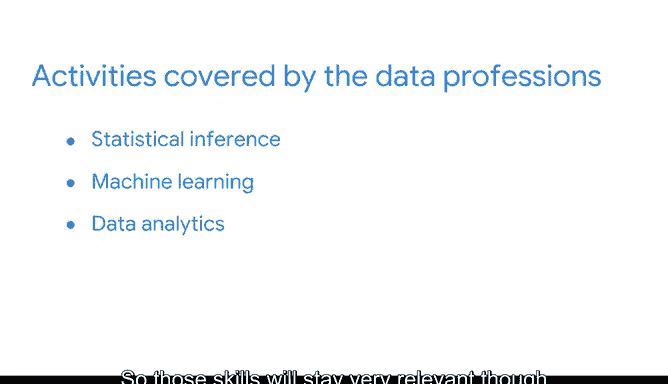

# 谷歌高阶数据分析1：《数据科学基础》foundations-of-data-science（中英双字） - P19：19_03_03_数据职业的未来展望.zh_en - GPT中英字幕课程资源 - BV1px4y1d7Mj

When investigating a possible new career path， one of the most important things to consider is its outlook and potential for growth。

Predictions about careers related to data analysis show that there is no shortage of need for professionals in this field。

 Over the last decade， data focused careers have searchedd。 According to estimates by LinkedIn。

 the data science field grew by over 650% between 2012 and 2017。

Many experts believe that we have not yet seen the full potential of these careers。 In fact。

 the US Bureau of Labor Statistics stated that data science is one of the fastest growing career fields in the United States。

 projecting a 30% cent increase over the next decade。Among the data science professions。

 one of the fastest growing is artificial intelligence and machine learning。

 and we've seen significant advances in these areas in recent years。At its core。

 artificial intelligence or AI。Is the development of computer systems able to perform tasks that normally require human intelligence？

Thanks to growth in the data sciences， AI is now becoming more commonplace。

 These technologies will continue to evolve and provide more accurate results and richer insights。

And as AI increasingly becomes an essential component of data work。

 it's important to be aware of the human bias that can be imprinted within your work to counter this organizationsgans benefit most from building diverse teams of professionals from different backgrounds and different life experiences。

 Incorporating a wide range of perspectives and worldview promotes wider representation and yields more accurate results。

As we study the future of the data professions， I want to emphasize that data professionals have yet to realize the full potential of artificial intelligence。

As these types of technological innovations continue to evolve。

 we can expect that organizations will grow and adapt their business practices accordingly。

With wider and wider adoption of data analysis techniques。

 the most likely area for growth is in specialization。

 and we expect to see further subdivision of roles within data focused teams。Ultimately。

 what I want you to keep in mind is this。 The world is generating more and more data every year。

 So it's reasonable to expect labor that extracts business value from it to be able to earn its keep。

😊，More data means more demand for the three main activities covered by the data professions。

 statisticalistic inference， machine learning and data analytics。

 So those skills will stay very relevant， though their names might evolve over time。

In addition， constant innovation in the field offers you the opportunity for perpetual learning。

 growth and development。As you may already know， being a data professional means that your growth and success in this field depend on a desire to keep learning。

 In fact， that just might be the reason you enrolled in this program。And for that。

 Im so proud of you。😊，Continue to explore opportunities to evolve throughout your career。

 be proactive in acquiring new skills， keep growing， and you will always be ready for the future。

