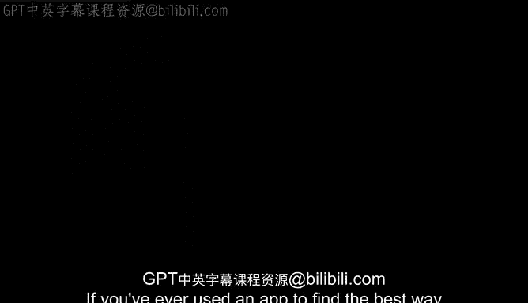
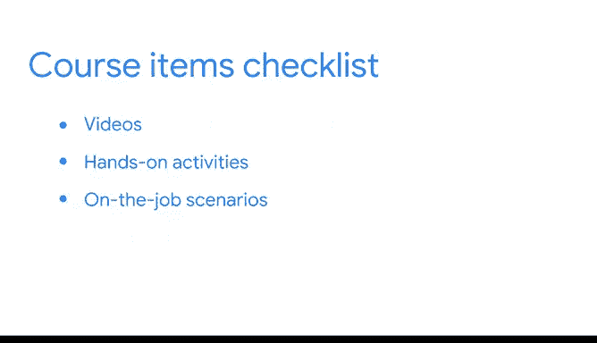

# 谷歌高阶数据分析1：《数据科学基础》foundations-of-data-science（中英双字） - P1：01_01_01_欢迎来到谷歌高级数据分析证书课程.zh_en - GPT中英字幕课程资源 - BV1px4y1d7Mj

If you've ever used an app to find the best way through traffic or received product recommendations while shopping online。

 you're already familiar with data analytics from the consumer end。According to some estimates。

 each person creates at least 1。7 megabytes of data per second on average。

That roughly translates into over 2。5 quintillion MBby of data being produced every single day worldwide。

As such， there is a huge demand now and for the foreseeable future for people who can organize data and interpret the stories locked within。

As you approach this career pathway， you're likely to bring practical experience in problem solving。

 decision making， allocating resources， time management。

 and many of the skills that are particularly suited for the job of a data professional。😊。

Many companies are searching for candidates to fill positions in this fast growing。

 high paying field。 My name is Cassie， and I've been a data scientist since before we called it data science。

 I lead decision intelligence here at Google， and I'll be your instructor for the first course of this certificate program。

😊，Before I became Google Cloudown's chief decision scientist。

 I worked as a data scientist in Google research， where I was involved with over 400 projects all across Google。

 One of my favorite things about the data science career is the tremendous variety。

 especially if like me， you're a naturally curious person。

 There are so many different flavors of project and challenge。

 Some of us choose to work on one project for years。

 Others get involved with several new projects every week。 The possibilities are endless。😊。

A data professional is a term used to describe any individual who works with data and or has data skills。

At a minimum， a data professional is capable of exploring， cleaning， selecting。

 analyzing and visualizing data。They may also be comfortable with writing code and have some familiarity with the techniques used by statisticians and machine learning engineers。

 including building models， developing algorithmic thinking。😊。

And or building machine learning models。Machine learning is an alternative approach to automation。

Expressing the way you want a task done by using data instead of explicit instructions。

Machine learning is an important component of the modern data professionalsessional toolkit。

To train a machine learning model， specialists put a bunch of potential data inputs through algorithms。

 tweak the settings and keep iterating until promising outputs are produced。

 but training a model is only one small step in the professional machine learning journey。

Machine learning techniques can also be used for data analytics and exploration with far fewer steps。

 and that's what you'll learn in this program。😊，You'll discover additional opportunities to explore machine learning through the course resources。

 so do check those out data professional work spans a wide range of industries and impact affects a multitude of products and services。

As we'll discuss later， there are also lots of different roles and titles that focus on data professional work。

 Think of them as data detectives， analyzingly and interpreting their findings to reveal the stories within。

I'm excited for you to get to meet some of them in this program。

Google Care certificates are designed by industry professionals with decades of experience here at Google。

 You'll have a different expert from Google to guide you through each course in this program。😊。

We'll share our knowledge in videos， help you practice with hands on activities and guide you through scenarios that you might encounter on the job。

 This certificate is designed to prepare you for a job in 3 to six months。

 If you work on the certificate part time。 So this program is really flexible。

 You can complete all of the courses on your own terms and at your own pace。😊。

Throughout the program we'll give you resources that will prepare you to advance in your career as a data professional。

 As you progress， you will also build a repository of portfolio projects and a comprehensive capstone project that will showcase your abilities beyond your resume。

 You'll also have a supportive network of peer learners taking the certificate with you。

 This program is designed to give you experience by building upon the knowledge and skills that you've developed to this point。

Regardless of your experience with data and analytics as you begin the program。

 you'll learn about different experiences that are relevant and helpful for starting or advance your career。

😊，In addition to building your skill set， we'll examine how teams of data professionals collaborate and contribute in the workplace。

By the end of this program， you'll be ready to pursue a position in the data career space。

By completing a Google career certificate like this one。

 you'll develop the skills and knowledge necessary for a job in this expanding career field。

 Once you graduate， you can connect with hundreds of employers who are interested in hiring Google career certificate graduates。

 whether you're seeking to switch careers level up your skills or start your own business。

 The Google career certificates can help you take that next step。😊，Throughout this first course。

 I'll be here to help you gain foundational knowledge needed to succeed in the field。Again。

 I'm so glad you're here。 I'm excited for you to take these next steps forward in your career。

 I'll see you in the next video。😊。

