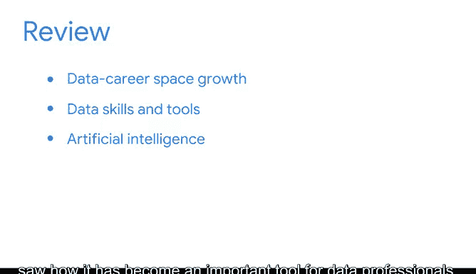

# 谷歌高阶数据分析1：《数据科学基础》foundations-of-data-science（中英双字） - P20：20_03_01_总结_3.zh_en - GPT中英字幕课程资源 - BV1px4y1d7Mj

As you approach the end of this section， Let's take a few moments to review some key concepts before moving ahead。

We saw that the data career space has experienced amazing growth over the last decade。

 Future predictions indicate that this should continue。

 You also discovered that data skills and tools are becoming more universal。 At the same time。

 Exp foresee a continued specialization of roles within the different fields。

 We were introduced to artificial intelligence and saw how it has become an important tool for data professionals。

 While we reflect on the information we've covered so far。

 Please remember that you are not taking these steps of personal and professional growth alone。😊。

Coming up， we'll take a closer look at the skills needed by data professionals。

And we'll investigate how larger organizations incorporate data analysis。

I'm looking forward to joining you as we continue your journey。 I'll see you in the next video。😊。

