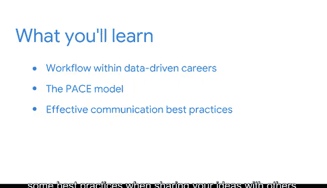

# 谷歌高阶数据分析1：《数据科学基础》foundations-of-data-science（中英双字） - P21：21_04_01_欢迎来到模块4.zh_en - GPT中英字幕课程资源 - BV1px4y1d7Mj

We began our journey into the data professional world by covering the basics of data science。

 exploring careers and discussing skills needed to succeed。😊，In this section。

 we'll investigate the workflow within data driven careers。

 You'll be introduced to a helpful organizational tool called the Pa model that can provide structure while allowing great flexibility when working on projects。

 We'll explore the elements of effective communication and some best practices when sharing your ideas with others。

😊。

All of these skills and tools will help you prepare for your upcoming portfolio project。

 I know you're excited to continue。 So let's get started。😊。

