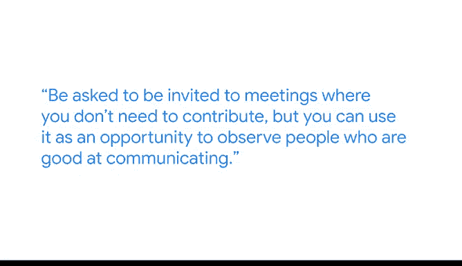

# 谷歌高阶数据分析1：《数据科学基础》foundations-of-data-science（中英双字） - P22：22_04_02_Hautahi谈数据科学职业中沟通的重要性.zh_en - GPT中英字幕课程资源 - BV1px4y1d7Mj

Hi I'm Otahi， I'm a C data scientist at Google。 I work primarily on equal treatment and algorithmic fairness in the YouTube recommend systems We try to make sure that our systems are fair。

And inclusive for both users and creators。 I don't think it's possible to have a successful data science career relying only on technical know how。

 If you rely just on technical know how and not effective communication。

 then you run the risk of misunderstandings and frustrations amongst your colleagues and stakeholders。

 My team tends to work across product lines within YouTube。 And so what that requires is reformulate。

What you're doing with team A in terms of the type of language that team B is more familiar with and the important differences between how they think about their products。

 the majority of your work relies on good communication。

 whether that's within then a small team that share technical knowledge or sharing that information across a broader range of stakeholders。

 a great way to show effective communication skills interview is by talking about specific examples。

 whether they be from previous jobs or in your personal life。

 they really illustrate that you've considered the question carefully。

 And this definitely doesn't need to be in data analytics。

 It can be in any experience that you've had previously in life。 And in fact， one of the。

Things I value about my data science colleagues as their broad range of backgrounds from a personal perspective。

 I don't think that my background is traditional at all。

 I am an immigrant to the USA I was raised in rural New Zealand on my tribal lands I Mdi and indigenous New Zealander and only spoke Mdi till I was about seven or eight years old。

 I think my Maluldi background helped in my communication skills because multiculture places a large emphasis on verbal communication I also think that previous jobs that not at all related to data analytics。

 for example， in college I worked at a hotel and got to speak to people from a wide range of backgrounds and was able to kind of learn communication skills just by doing that。

My advice to those who are maybe struggling a little with workplace skills and communication is to be asked to be invited to meetings where you don't need to contribute。

 but you can use it as an opportunity to observe people who are good at communicating the other is to maybe ask those people whose communication skills you admire to perhaps be a mentor and teach you some of those skills and in general just observe people who are good at communicating and that doesn't just need to be in the workplace environment but can be。

Elsewhere in your personal life， too。啊。

