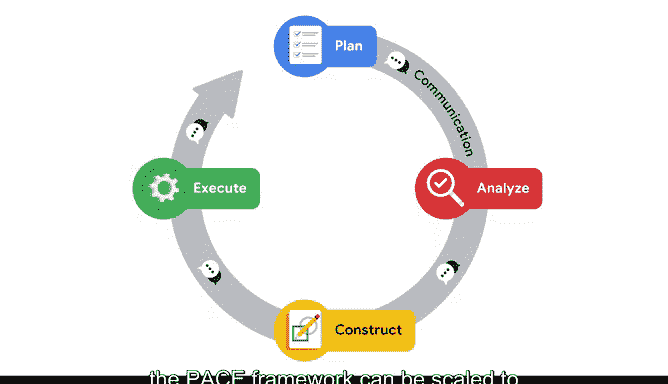

# 谷歌高阶数据分析1：《数据科学基础》foundations-of-data-science（中英双字） - P23：23_04_03_PACE框架简介.zh_en - GPT中英字幕课程资源 - BV1px4y1d7Mj

The most important part of any project is preparation。

 That involves thinking through all the necessary steps and anticipated tasks。

 Let's say you are planning a dinner party。 You would start by planning the theme， menu。

 the guest list and only other details。 Next， you might check the reservation list， Di restrictions。

 or take a trip to the grocery store for ingredients。 Afterward。

 you would return home to prepare your dishes， Clean your space， sett up the table and get ready。😊。

Because you set up so much beforehand， the evening will be awesome。

 While this scenario may be fictional or not， it offers some wise advice as a data professional。

 being able to visualize data， predict outcomes and quickly pivot away from obstacles makes you a problem solver and a great asset to any organization。

😊，Benjamin Franklin once said， by failing to prepare， you are preparing to fail。

After almost three centuries， it still applies。To something as simple as a dinner party or as complex as a deep space mission。

Regardless of the project， having a structural framework in place for how to get that work done can be immensely beneficial。

I've done a lot of data science consulting in my time and one of the most common problems I've seen is teams coming to me。

 thinking that they need advice on which tool or equation to use and all of us finding out during the meeting that they're solving entirely the wrong problem。

All the math in the universe won't help you if you don't point it in the right direction。

 but it's easy to get excited about those nitty gritty details and rush headlong into a waste of time。

 The best teams I've worked with have adopted a framework to help them focus on the most impactful actions in the most efficient order。

 And they've had the discipline to use it to stay on track instead of running off into the weeds。

 For those of you who completed the Google data Analytic certificate。

 You'll recall a structure for the data workflow that was divided into six phases。😊，Ask， prepare。

 process， analyze， share， and act。This framework is quite useful for a multitude of projects。

 but often with bigger data sets， you need more freedom and flexibility。

The pace framework designed for this program offers the same workflow and structure but in a simpler way。

Pace is a framework developed with input and feedback from our team of data professionals。

 The intent of Pace is to provide an initial structure that will help guide you through projects。

The goal is to lay a foundation upon which you will develop your own workflow practices。

The pace framework helps you solve problems and make judgments quickly and efficiently。

Pace is an acronym。Each one of the letters represents an actionable stage in a project。 plan。

 analyze， construct and execute。In the plan stage， you'll define the scope of your project。

 You'll begin by identifying the informational needs of your organization。

This is where you'll want to ask yourself questions like the foeing。

 What are the goals of the project， What strategies will be needed。

 What will be the business or operational impacts of this plan。

Taking inventory of the project and the tasks required will help you get a better understanding of the context of your work。

And prepare for success。During analyze， you'll engage with the data。

 You'll start by preparing it for your project。 Here you'll acquire the necessary data from primary and secondary sources。

And then you'll clean it， reorganize it， and transform it for analysis。

Then you'll conduct a methodological examination of the data。

You'll also engage in exploratory data analysis or EDA for short。

This will involve converting the data into usable formats。

Assessing the quality of the data and then diving into the data to find as many potentially useful insights and directions as possible。

You'll then work with your stakeholders to see which of those areas are worth pursuing in more detail。

 which brings us to the construct stage where you're going to pursue a limited subset of all those potential insights that looked interesting to you in your E D A。

And here is when you will work with other data professionals。

 potentially statisticians and machine learning engineers to do things like building machine learning models and revising those。

Uncovering relationships within your data。And doing statistical inference about those relationships。

 Finally， in the execute stage， you will share the result of your analyses and your collaboration with your stakeholders。

😊，As well as。The value that you've unlocked from your data。

Here you will present findings to internal and external stakeholders。

 answering questions and considering different viewpoints。

You'll also have an opportunity to present recommendations based on what you found in the data。

You may discover that you revisit the planning and analysis stages。

As you refine models and incorporate feedback， a good way to visualize the pace framework is as a completed circuit。

Each of the four stages must be engaged for it to function correctly。

 The electricity or flow of energy in the pace circuit is the communication between you。

 your team and all the other stakeholders and collaborators involved。😊。

When you look at the stages in this manner。You might think that communication only flows one way。

Well， you always do start with planning， but don't be afraid to go back and iterate with pace。

 new information and feedback can be incorporated in any part of the process。

You might need to return to analyze to clarify some aspect of the data and then jump back to execute。

 to present this aspect to your stakeholders without the need to construct new models or dashboards along the way。

You'll see how the pace framework can be scaled to fit within the scope of any project。

The model's adaptability will prepare you for a dynamic profession that requires a high degree of professional flexibility and communication。

Regardless of where your career takes you， the pace framework is a tool that provides a clear foundation and structure。

Through the continued application of the pace framework。

 you'll prepare for each course's portfolio project。

 Then you'll have the opportunity to practice your evolving skills。

 Each portfolio project will introduce opportunities to develop and strengthen your organizational methods。

😊，As you develop your own intuitive workflow， the pace framework can be a great organizational tool。

 Next， we'll look at how communication is so crucial。😊。

