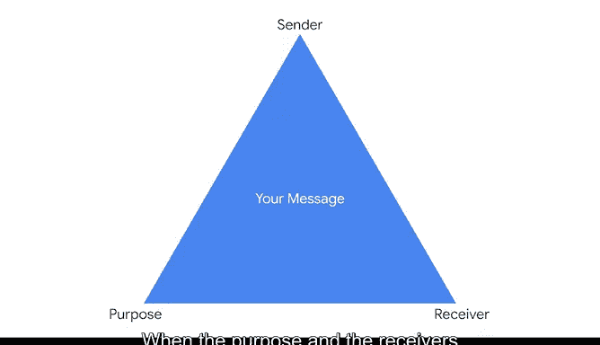

# 谷歌高阶数据分析1：《数据科学基础》foundations-of-data-science（中英双字） - P24：24_04_01_沟通的核心要素.zh_en - GPT中英字幕课程资源 - BV1px4y1d7Mj

When I was a kid， I still loved to take things apart so that I could see how everything came together on the inside to make something work。

 I actually still love doing that today。 And this is so much easier to do with tangible things that you can hold and look at like a pen。

 for example。😊，I can twist the tip to pull each section apart from there。

 I can pull the ink cartridge out and check out the way that the spring works in tandem with the top part of the pen to make it click。

😊，Studying the way things work becomes much harder when we start thinking about abstract concepts like communication。

And you're probably wondering why it's important to talk about it in the first place in your role as a data professional。

 you are the direct connection between the information inside the data and other project stakeholders。

 So let's take a closer look at some key considerations when crafting a message。

All the communicative exchanges have three key elements that we need to keep in mind。 Pur。

 receiver and sender。When we think about purpose， I want you to think about the reason why the communication is taking place。

In analytically oriented settings， you might find yourself in situations where technical pockets of information require analysis or reporting。

On the other hand， there may be contexts that depend on strategic insights。

 which will be used to direct a company's financial or organizational efforts。

The receiver is your audience。When you think about the receivers of your messages。

 I want you to think about who you are talking to。It's helpful when crafting communications to ask。

 what does my audience already know， What do they need to know。

 And it's important to keep in mind that every exchange can cause a rippled chain of events。

 As the data professional。 You're often working as part of a distributed team across an organization。

 And that's why a message shared with one receiver may be used for reporting with or to others。

 The sender is the person responsible for crafting that message or communication。 Yes， you。

 You're the sender。 The sender is a crucial part of any communicative exchange。 As the sender。

 I encourage you to think about the following， What's your relationship to the receivers。

 What's your role in this exchange。😊，Are you reporting insights。

 Are you pitching ideas or are you identifying potential data inputs。 Also。

 what personal biases might affect the message you're trying to share。

At the heart of the relationship between purpose， receiver and sender is the message or communication that you intend to share。

 which is impacted by all three elements。For this reason。

 the same message might be shared in dramatically different ways when the purpose and the receivers change from scenario to scenario。

For example， you might know a data professional working on a complex project。

They've been involved since the project was sparked by an idea in a meeting。

The way they articulate the project pitch， structure， research。

 models and findings will change depending on whom they are talking to。With non technical audiences。

They're much less likely to focus on details about the code used to program the model。

 and instead they'll focus on the impact of the project。When the audience shifts to other colleagues。

 your friend may instead choose to be very detailed about the code and project logistics。

In both cases， the overall message exchanged。 that is， information about the project was the same。

How it was crafted， the details included and the way the information was organized。

 that's what was different。Now that we've examined the key elements of communication。

 we can really start to think about some of the best practices that will set you up for success when you communicate in your future job。

