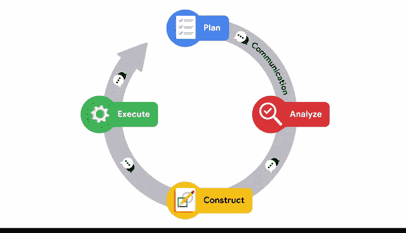

# 谷歌高阶数据分析1：《数据科学基础》foundations-of-data-science（中英双字） - P25：25_04_04_沟通驱动PACE框架.zh_en - GPT中英字幕课程资源 - BV1px4y1d7Mj

Previously， you were introduced to the Pace framework As a reminder， Pace has four stages。 Plan。

 analyze， construct and execute。 We also examined the rationale and key elements involved in effective communication。

 Now， let's investigate how they can be integrated together within data projects。😊，At first glance。

 the pace framework easily enables a wide view of an entire project's workflow。

 That is each stage from planning to executing is logically sequenced with the beginning middle and end of a data project。

 As you may recall， though， pace is incredibly flexible。

 And it doesn't need to be employed in a linear progression。 Often。

 iteration makes sense in projects。 So let's unpack that with an example。 For reference。

 we can compare it to the construction of a building。 First， a blueprint is created。

 This is where the planning happens。 Next， we lay the foundation。

 we can do this once we've analyzed the lot space。 and considered other variables like cost。

 Then we add the frame。 After that， the roof can be installed。

 By the time the structure is ready for move in。 The builder will have progressed through the entire workflow。

 planning， analyzing， constructing and executing the client's vision。😊，In practice。

 the pace workflow is meant to serve as a navigational tool。

 We created it with the goal of helping you understand the data professionals workflow and as an aidide you can consult in your future role。

😊，Now， let's return to the example with the roof completed。

 that makes it possible to begin the inside construction， like installing drywall。

 electrical components and plumbing systems。Each of these jobs also has its own pace workflow demonstrated on its own planning document within the larger blueprint。

 each requiring planning， analyzing， constructing and executing。

 just like the building example we've been discussing as data projects move into the construct and execute stages on the global level。

 you may need to return to the earlier stages to incorporate additional data or feedback from other stakeholders。

 even while the global project is transitioning into a new phase of pace。

 there can still be upcoming tasks that are just beginning their pace cycles。

Regardless of where you might be in the pace workflow。

 communication is what drives the framework to the realization of the project at each stage within the framework。

 there will always be a need for communication to improve the workflow。

This could be asking questions about your data， gathering additional sources。

Updating stakeholders on progress or presenting findings and receiving feedback。

One of the most important considerations behind the development of pace was providing a flexible structure that allows you to adjust changes within a project。

Let's return to our building example。Let's say that during the installation of the electrical system。

 the property owner has communicated that they wish to have an additional charging port for electrical vehicles added to the plan。

To facilitate the change， you would revisit the pace framework to plan， analyze。

 construct and execute this new request。 Just like in this example。

 requests from other stakeholders can come in at any time。

Regardless of the timing of an additional request or task。

 Data professionals need to be available and accessible throughout the entire project cycle。

 Sometimes you may need to speak at a meeting or participate in a progress update， Additionally。

 you may update your progress within a tracking system email conversations and chat discussions will keep others involved and up to date with where you are in your workflow。

😊，I'm excited for you to develop some hands on experience。

 practicing different communication strategies through each stage of pace。

 You'll have opportunities to do this later in the program。 For now。

 I want you to remember that a good data professional is a proactive communicator who responds to questions in a timely fashion。

😊，Keeping other stakeholders up to date with clear explanations can make you the most effective data professional that you can be。

