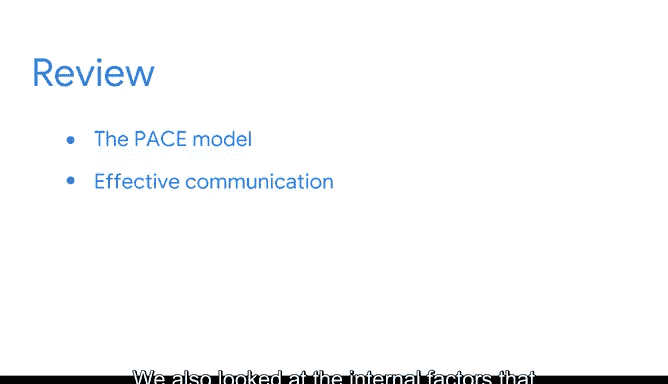

# 谷歌高阶数据分析1：《数据科学基础》foundations-of-data-science（中英双字） - P27：27_04_01_总结_4.zh_en - GPT中英字幕课程资源 - BV1px4y1d7Mj

You've reached the end of the data workflow overview。You've covered a lot of material and concepts。

 Great job。 You saw how the pace framework can be used to help structure and guide you through projects。

 Next， we learned about effective communication and how it can be used within the pace framework。

 We looked at the external factors that can have an impact on data analysis。😊。

We also looked at the internal factors that can have an impact on data analysis like bias within data。

As you're preparing for the weekly challenge， don't forget that you can review any of the materials we covered in the next section。

 you'll begin working on your first portfolio project。I wish you the best of luck。

