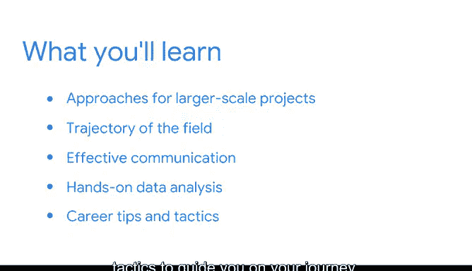

# 谷歌高阶数据分析1：《数据科学基础》foundations-of-data-science（中英双字） - P2：02_01_04_课程1简介.zh_en - GPT中英字幕课程资源 - BV1px4y1d7Mj

Now that you have a general understanding about this program overall。

 let's talk a bit more specifically about what you can expect in this course。

We'll start with the basics and a little background on what the data field offers。

While you may already be familiar with work within the data field。

 I'm excited to dig deep into some history that shows us where we've been。

 where we are and where we're going in this field。 These key developments and applications will really showcase all the opportunities this program will help prepare you for In this first course。

 We'll discuss the specific skills and characteristics that organizations look for in future employees。

 You'll develop the core skills necessary to advance on your journey as a data professional and integrate these skills with your own preexisting abilities。

😊。

We'll focus specifically on technical and workplace expectations。

There will also be plenty of chances to practicerac along the way。

 Then we'll explore your job market opportunities。 You'll learn about the variety of roles and positions that match your skill set。

😊。

You'll also investigate the responsibilities and ethics that underpin all roles within the data career space。

With the increasing number of industries that are turning to the data professions。

 you're bound to find a role that fits your interests。

 And we'll also explore some of these industries so you can see where data professionals are employed to make more informed decisions。

Then we'll examine how larger organizations create teams of data professionals to approach larger scale projects。

 We'll also peek into the future of data careers and the trajectory of the field in general so that you have a good sense of what the future holds for you after completing this program。

😊，We'll also investigate elements of effective communication and discover how it can empower you as a data professional。

Throughout this course and the whole program， you will see how effective communication can elevate productivity and promote general understanding during the data analytics process。

As you progress， you will gain hands on data analysis experience through your portfolio projects。

 beginning with the first one in this course。We've designed a few different options for you to apply your data skills to actual scenarios with data shared by our industry partners。

And you can use these projects to showcase your skills to future employers。Lastly。

 our instructors will provide a few career tips and tactics to guide you on your journey。

 That's a short preview of what to expect later in this course。 Next。

 you'll have the opportunity to go over some resources that' will help you get the most out of this program。

😊。

I'll see you in the next video。

