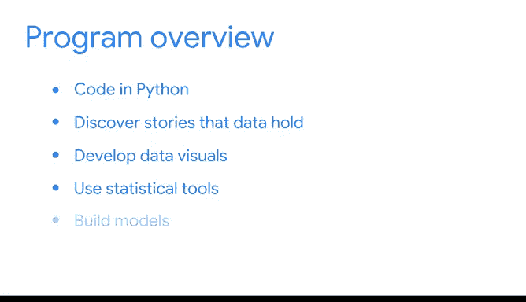

# 谷歌高阶数据分析1：《数据科学基础》foundations-of-data-science（中英双字） - P4：04_01_01_欢迎来到模块1.zh_en - GPT中英字幕课程资源 - BV1px4y1d7Mj

Hello again， let's discuss some of the course items you'll encounter in your learning journey In this program。

 you'll code in Python， Disc the stories that data holds， develop data visuals。

 use statistical tools， build models and even dabble with some machine learning。

Along the way， you'll build a portfolio full of data projects。

 in addition to this program's capstone， whether you are looking to switch careers。

 start a new career， Im your skills， or advance beyond your current role in a company。

 the Google career Cs can help guide you as you take steps towards new opportunities。😊。

We've gathered some amazing instructors to support you on your journey。

 and they'd like to introduce themselves now。😊，Hello， I'm Adrian。

 and I'm a customer engineer at Google。Together we will explore one of the fastest growing programming languages。

 Python。You'll learn the basics， which will help you write scripts that perform a number of key mathematical operations on data sets。

 all designed to help you unlock the stories within data。😊，Hi there。 I'm Rob。

 I'm a consumer product leader。 I work on marketing projects here at Google。

 I'm excited to talk to you about how to tell stories using data。😊。

We'll discuss the six practices of exploratory data analysis and how to identify the trends and patterns in it。

We will also learn about the importance of designing and presenting data visualizations using Python and Tableau。

 which can help you understand your data and convey it to others。Hello， my name is Evan。

 I'm an economist， and I consult with various teams across Google。

 Statistics helps you generate more complex ideas from the data itself In our time together。

 you will discover how you can generate insights， draw conclusions， make inferences。

 create estimates， and make predictions。😊，Hello， I'm Tiffany and I'm a marketing science lead and I work with marketing data here at Google。

I will guide you through the process of modeling relationships between variables together we'll explore different regression models and hypothesis tests we'll also talk about model assumptions。

 construction， evaluation and interpretation as the means for answering data driven questions。Hello。

 I'm Saila。 I'm a data scientist， and I work on projects for YouTube here at Google。

 I'll guide you through building systems that can learn and adapt without a specific set of instructions。

 We'll discuss how machine learning is transforming the process of data analysis as you construct your own models。

😊，Hello， I'm Tiffany and I lead team focused on building AI responsibly here at Google。

 I'll introduce you to career resources and portfolio projects and guide you through the capstone course at the end of the program。

I'll assist you with different opportunities and tools that will set you up for success on the job market。

And， of course， you already know I'll be guiding you through course 1。

 This is such a great time to grow and advance your career as a data professional。

 Your path to a career full of new opportunities awaits。😊。

