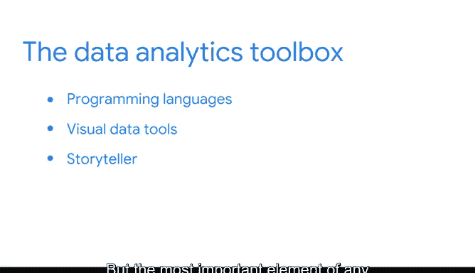

# 谷歌高阶数据分析1：《数据科学基础》foundations-of-data-science（中英双字） - P5：05_01_03_探索您的数据工具箱.zh_en - GPT中英字幕课程资源 - BV1px4y1d7Mj

Ol professions require a certain set of tools for success， and data driven work is no different。

 In this video， we'll open our analytics toolbox and look at some of the most common items。

Before we begin， I want to emphasize that each of the items serves their own individual purpose。

 However， when used together， they help build and tell stories with data。Which can then inform。

 influence and impact business decisions。Programming languages are the first tools we'll investigate。

 They allow data professionals to work efficiently within and dissect large data sets。

Most languages have been developed over time， and each data professional has their own preferences。

 We'll mention two in this video that have become very popular for data analysis。

 The R programming language and Python。 R is a programming language that's used extensively by researchers and academics。

 It was my primary language during graduate studies in statistics。

 And some people say that R captures the statistician's mindset。

 I'd say there's something to that sentiment。😊，If you're after implementations of the latest statistical breakthroughs are is a great place to look。

 but it's used for more than statistics。 You'll find many new technologies and ideas programmed with it。

😊，One of the best features of our is that you can create complex statistical models from just a few lines of code。

 If you're curious about R or need a refresher， be sure to check out our Google data Analytic certificate also offered here on this platform。

 This program teaches the Python programming language。😊，It's a great choice for a few reasons。

 First of all， it emphasizes readability， making it one of the easiest programming languages to learn and write。

 Second， unlike R， Python wasn't born in the data community。 While this might sound like a minus。😊。

It can also be a huge plus。 in the modern world， data is used in increasingly creative ways。

 So there's a massive advantage to learning a programming language that's capable not only of handling the data side of things。

 but can also be used to build and deploy the applications that data will be fueling。😊。

Although R was my first love these days， I find that I lean more heavily on Python because of its flexibility。

 Python can perform a wide variety of data related tasks。

 which makes it very popular among data professionals。😊。

If you are a novice or new to coding completely， Python is a very approachable language。

 Its formatting is visually uncluttered。 It's one of the most beginner friendly languages。

 and it has enormous online communities and plenty of resources to help you if you get stuck。😊。

We will interact with Python within a web based computing platform also called Jupyter Notes。

 which allows you to run code in real time and helps identify errors easily。

To visualize the stories in the data。We're going to teach you how to share complex data through a graphical interface。

Those who experienced our data analytics program will be familiar with a platform called Tableau in this program we'll take a more detailed look at how this powerful tool can help others understand the results of your analysis。

Additionally， we'll look at effective communication in data driven careers。 At first glance。

 it might seem like less of a concern。But describing the sometimes complex processes of data analytics to non technical stakeholders may be one of the most important skills a data professional can have。

 since communication is something we all do regularly。

 It's easy to forget about the importance of how data professionals share and process data stories。

 Our goal here is to strengthen the communicative skills that you already possess。

 so that you can leave this program equipped to excel。

In this course specifically and across other segments of this program。

 communication will be a key component that is directly tied to the work you'll do as a data professional。

 Programing languages allow data professionals to interact with and interpret data。😊。

Visual data tools like Tableau enrich the stories within data with visual elements that bring attention to specific details。

 But the most important element of any story is the story telleller。 That's you。

Your prior experiences and knowledge inform your story telling abilities。

 and your distinct background is what will set you apart from others in these roles。

 regardless of your eventual career path， remaining determined and developing the proper skills。

Is essential to personal and professional transformation。

And the tools we're offering you in this program will also help you along the way。

I'm thrilled to continue alongside you in your journey。 The best is yet to come。 I'll see you soon。😊。

