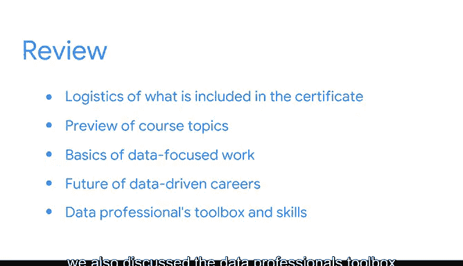

# 谷歌高阶数据分析1：《数据科学基础》foundations-of-data-science（中英双字） - P6：06_01_01_总结_1.zh_en - GPT中英字幕课程资源 - BV1px4y1d7Mj

Congratulations on completing the first part of this program。

 You've officially begun your journey to new opportunities in the data field。😊。

Let's revisit what we've covered so far。 First， we covered the basic logistics of what's included in the certificate。

 You met each of your instructors， and we previewed some of the different course topics you will encounter。

Next， we looked at the basics of data focused work and some of the industries that are incorporating data insights。

We also discussed the future of data driven careers。

In addition to exploring what it's like to work in the data field。

We also discussed the data professionals toolbox and the skills this program will help you develop。

 Congratulations on your progress so far。 I can't wait to see you in the next video。😊。

