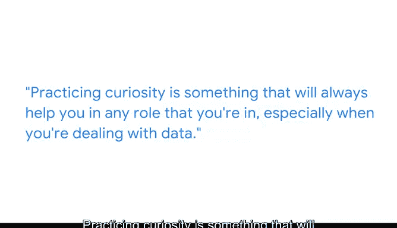

# 谷歌高阶数据分析1：《数据科学基础》foundations-of-data-science（中英双字） - P7：07_01_03_Lois的好奇心引领数据职业航向.zh_en - GPT中英字幕课程资源 - BV1px4y1d7Mj

Hi， my name is Luanne and I' am an industry intelligence lead at Google what that means is that I help to make both our internal teams and our partners and advertisers a lot smarter about the industry that they work in。

Early in my analytics career it was actually pretty lonely and so I had a really big need to connect。

I could not find a job immediately out of college， and I had done lots of things。

 work different places， didn't really build deep enough connections to have a community of people in this area Earl on。

 I started joining some networks Networking is critical when entering a new field。For me。

 what was most jarring about this new thing was just the newness of being new。 right。

 So you feel like a fish out of water。 You are also subject to that very pesky imposter syndrome。

 I'm not good enough to be here， They're going to find me out。

 And so having a network who is able to re me back in and say， no， you're qualified。

 And here all the reasons why you're qualified。 And actually。

 here's how these other skill sets you have make you an asset here was immensely valuable。

 In my role。 currently， I collaborate with tons of different people and data analytics。

 Collaboration is important because there are so many diverse parts of the story。

 so you need people who are willing to and able to and good at asking the questions which are。

 you know， what exactly are we looking for。 Are we looking in the right place。

 You need people who are then able to query and find a set of data find the needle in the haystack。

 You need other people to find the pattern and to find what the insight。

IFrom the data and then you need people to tell the story practicing curiosity is something that will always help you in any role that you're in。

 especially when you're dealing with data， and beyond that。

 you know you have this opportunity to connect with your cohort you are the next generation of advanced data analytics practitioners and so getting to know one another getting to understand what you're all thinking and even you opening up the door to innovate together is a super important and exciting opportunity。

