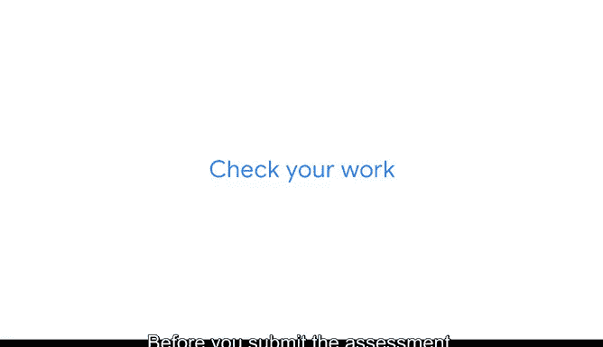

# 谷歌高阶数据分析1：《数据科学基础》foundations-of-data-science（中英双字） - P8：08_01_01_准备首次评估.zh_en - GPT中英字幕课程资源 - BV1px4y1d7Mj

As you know， this program asks you to complete a graded assessment at the end of each section and course。

And now's the time to prepare for your first one。This assessment will effectively verify your understanding of key data analytics concepts。

 It will also help build confidence in your understanding of data analysis。

 while identifying any areas where you can continue to improve。

Assessments can sometimes feel overwhelming， but approaching them with a strategy makes them more manageable。

 Here's a list of tips to set yourself up for success。Before taking an assessment。

 review your notes and the videos， readings and the most recent glossary to refresh yourself on the content during the assessment。

😊，Take your time。 Review the whole test before filling in any answers。Then answer the easy questions。

 S the ones you don't know the answer to right away from multiple choice questions。

 focus on eliminating the wrong answers first。Also， it's a good idea to read each question twice。

 There are often clues that you might miss the first time。If you start to feel anxious。

 calm yourself with some mental exercises。 One way to do that is by completing a simple math problem in your head or spelling your name backwards。

This also helps you recall information more easily Before you submit the assessment， check your work。

 but be confident。 Sometimes people change an answer because it feels wrong。

But it's actually correct。 Your first instinct is often the best one。Finally。

 remember to trust yourself。Often， people know a lot more than they give themselves credit for。

Everyone learns at different speeds， and in different ways。

But it's important to maintain your momentum。 So take the time you need。 And when you feel ready。

 keep moving ahead。 You've got this。