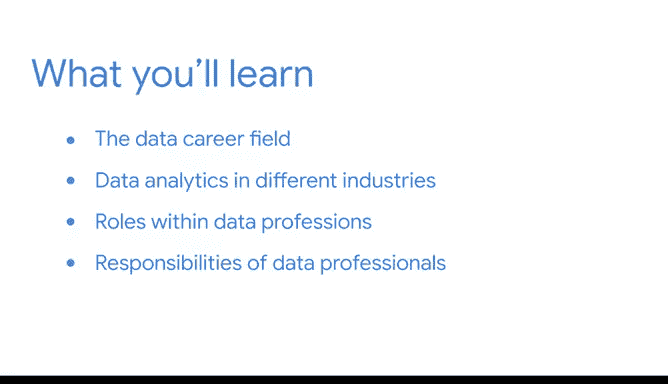

# 谷歌高阶数据分析1：《数据科学基础》foundations-of-data-science（中英双字） - P9：09_02_01_欢迎来到模块2.zh_en - GPT中英字幕课程资源 - BV1px4y1d7Mj

Great to have you back。 Im so delighted to be your guide as you continue on your way to becoming a data professional。

😊，As you've been discovering， data can be used in many ways， but no matter how it's applied。

 the key thing to keep in mind is that knowledge is power， the power to improve your business。

 your work， your personal life， and the world around you。With all of the data surrounding us。

 there's just so much potential waiting to be unlocked。

I'm so glad that you've chosen to learn more and to be a part of it。😊。

And speaking of your learning journey in this section of the course。

 we'll start by finding out more about data careers。

 We'll explore different industries and examine some direct applications of data driven work。😊。

We'll investigate some of the roles within the data professions and take a closer look at the general categories that you'll encounter。

 We'll also look at the responsibilities of different data professionals。

 I'm so excited for you to get started。 Let's go。😊。

