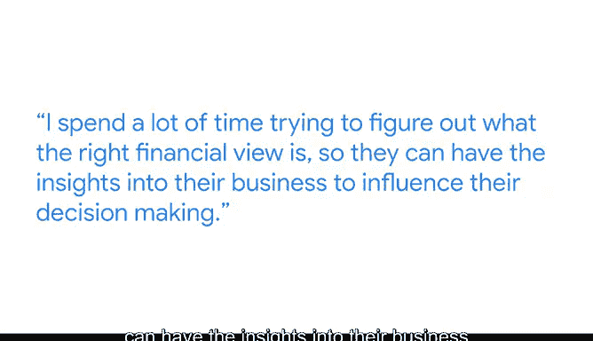

# 谷歌高阶数据分析3：《超越数字：将数据转化为洞察》go-beyond-the-numbers（中英双字） - P10：10_02_02_亚瑟-理解数据以驱动价值.zh_en - GPT中英字幕课程资源 - BV1Tz4y1t7PN

My name is Jessier and I'm a senior financial analyst at Google I was born in Nicaragua and I immigrated to the United States when I was two years old。

 grew up in inner cityity Philadelphia after high school I joined the United States Marine Corps spent time in Japan。

 South Africa， Saudi Arabia and Panama one of the big reasons I got interested in finance is because when I was in my first duty station in South Africa I befriended the ambassador who had previously worked in Wall Street he took me under his wings and mentored me and taught me a lot of things about personal finance。

 corporate finance and the global economy and my mind shifted from I'm going be Marine forever to I'm gonna get out of the Marine Corps after my four years and go back to school and who worked out I learned about advanced data analytics on my own actually between random YouTube channels just googling stuff I got into big。

The analytics， partly because to understand and drive value in your organization。

 you have to really understand the underlying data as a senior financial analyst。

 the typical day in the life really is focused around a couple of things working with strategic business partners I spend a lot of time trying to figure out what the right financial view is so they can have the insights into their business to influence their decision making completing an online course like this。

Is difficult when you look at that course schedule and see that it's three months or six months long。

 Just focus on that next day and stick to your schedule， show up every day。

 It's like running a marathon。 You know， you're not running 26。2 miles。 You're running 1 mi，26。

2 times。 Just focus on the very next thing。 I believe in you， You can do it。

