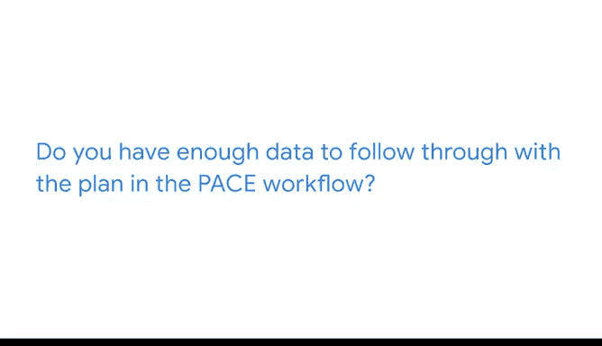

# 谷歌高阶数据分析3：《超越数字：将数据转化为洞察》go-beyond-the-numbers（中英双字） - P11：11_02_03_数据来源解析.zh_en - GPT中英字幕课程资源 - BV1Tz4y1t7PN

Imagine for a moment you're preparing a meal for friends。 You have a recipe and raw ingredients。

 but this is the first time you'll cook the dish。 Of course， youll want your friends to enjoy it。

 if you're like me the idea of being judged on perfectly preparing a recipe the first time you've made it is scary。

Believe it or not， this cooking example is what it's like to be a data professional during the discovery practice in EDA。

The recipe you're trying to follow is equivalent to your company's project plan。

You have everything you need at your disposal， a kitchen。

 or a digital workspace with dedicated servers for data analysis computing。

Raw ingredients or a data set， and it's up to you on how to best mix。

 blend and cook the ingredients in order to make a winning dish that your friends will enjoy。

In this video， let's focus on raw ingredients As a data professional。

 you will be handling all kinds of different data in a number of different formats and file types。

I will share with you the most common data sources， data formats， data types。

 and a few Python functions。Once you're familiar with the dataset source， format。

 and the data types within it， you'll be ready to handle questions or challenges as they arise during the analysis。

😡，First， when you're given data， you'll want to know the source。😡。

The term data source can have many different meanings in different contexts， but for our purposes。

 we'll be defining data source as the location where the data originates。

One good thing to know about a data source is how and when to contact subject matter experts such as engineers or database owners。

These are the people who either generated data or are in charge of delivering the data sets。

When you have questions about the data， as you do your discovery。

 they will be the ones you reach out to。Knowing the ownership and source of the data is critical because by understanding the data source and who is responsible for it。

 you can determine its reliability。Does the data owner have experience collecting and storing data？

Does the data owner have any financial stake in the data's output？

Understanding the source of the data will help you in telling the story of the data and make ethical decisions about its use。

Another important part of determining the data source is understanding how it was collected。

 whether the data was collected through a report from a computer system。

 a custom selection from a large online database or a data table that has been manually entered。

 knowing about how the data was gathered will help you understand questions that may come up during EDA。

😡，For example， missing values could mean many different things。

 maybe the database owners either didn't know or didn't want to disclose the data for manual entry。

 or there might be lagging data or a system bug from an online database。

The next thing you'll need to know about your data sources is the data file format。

The main data formats you'll experience as a data professional are tabular files， XML files。

 CSV or comma separated value files， spreadsheets， database files， or JSON files。

 which stands for JavaScript Object notation。Here are a few examples of what these file types look like。

If you've gotten this far into the program， you'll be familiar with tabular and Excel files by now。

 As you know， they organize data in tables with data variables organized by rows and columns rows representing the objects and columns representing aspects of the objects in the data set。

😡，The advantage of this file type is a clear identification of patterns between variables。

CSV files are a simple text file which can be easy to import or store in other softwares。

 platforms and databases。 They look like rows of text and numbers separated by commas or other separators。

The rows of data are broken up by commas rather than strict columns。

The advantage of CSV files is more from a computer science aspect in that it is really a file type which is easily read。

 even in a text editor。It is also easy to create and manipulate。In Python。

 you can use the Read CSV function to read， write， and work with tabular data that is in the CSV format。

Databbase or DB for short， is another way of storing data， often in tables， indexes， or fields。

Database files are great for searching and storage。

They often require some basic knowledge of structured query， language， or SQL。

We will explore how to query data from databases in an upcoming section。Lastly。

 JSON files are data storage files that are saved in a JavaScript format。😡。

You'll find the information in these files better resembles Python code， but with different language。

 function and format。😡，JSON files may contain nested objects within them。

 You can think of nested objects as expandable file folders or drop down menus within the code itself。

For example， a JSOsonN file might have the ingredients for a recipe listed。

 and under each ingredient， you would have included nested information like weight。

 calories and price as objects that define the ingredients。 There are few advantages of JSON files。

 They have a small message size。 They are readable by almost any programming language。

 and they help coders easily distinguish between strings and numbers。

 There are Python libraries and functions built for working with JSON files。 As you learn previously。

 you can import the JSson Python module into your Python notebook to use as an encoder and decoder of JSON files。

There are also tools in the pandas called Read JSON and2 JSON。

 which will translate JSON files and convert an object to JSON format type respectively。

As a data professional， you may also be tasked to find data stories in other formats like HTML。

 audio files， photos， email text， images， or text files。In every case。

 there are Python libraries or functions that can help you discover and structure the data for your research project。

There's no best format for the data。 It will depend on the project and storage type。

You're just looking for the format that best fits that particular data set。😡，Finally。

 the last raw ingredient in understanding data is types of data。

You may already be familiar with the many different categories of data as a reminder。

 there is a first， second and third party data。First party data is data that was gathered from inside your own organization。

Second party data is data that was gathered outside your organization。

 but directly from the original source。Finally， there's third party data。

 which is data gathered outside your organization and aggregated。Knowing the types of data。

 whether first， second， or third party will help you be able to more efficiently answer or seek answers to the questions you may have that arise during analysis。

For example， if there are missing values in first party data。

 then someone in your organization can help you determine whether the missing data can be recovered。

For third party data， you will likely have to reach out to a separate organization。

You'll also be familiar with different types of data like geographic， demographic， numeric。

 time based， financial， and qualitative data。Your job as a data professional require that you understand and work with all these types of data。

Knowing the data source， format， and type you're working with will help you to answer two very important questions first。

😡，Given what you know of the data so far， does it align with the plan as defined by your pace workflow？

And second， do you have enough data to follow through with the plan in the PA workflow？

If youve answered either of these questions with a no or not sure。

 it is your job to reach out to the owners of the data and project stakeholders to inform them of the issue you found。

😡，For example， let's say you're assigned to predict the number of customers a retailer will expect to see next month。

Unfortunately， you're only given profit margin data and only two months worth of customer purchase data。

Because the profit margin data won't help you with returning customers and only two months of data won't give you much confidence in prediction。

 you should go back to the data source。 you'll need customer purchase data from the last few years to accurately predict an upcoming month。

😡，Returning to the data source and requesting more data will keep everyone in the process。

 including you focused on the plan that was established as part of your PA workflow。😡。

When you are working as a data professional， keeping this focus will be essential in identifying and carrying out high priority and value add tasks。

As a data professional， you're expected to know what the data means and how to work with it to find solutions to business problems like cooking a meal。

 you'll be given the tools and ingredients you need to work on the problem。😡。

It is up to you to work with your team if there aren't enough ingredients or if what you've been given won't make a great dish。

