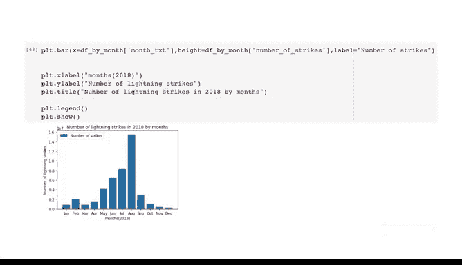

# 谷歌高阶数据分析3：《超越数字：将数据转化为洞察》go-beyond-the-numbers（中英双字） - P12：12_02_06_使用Python基础函数进行EDA.zh_en - GPT中英字幕课程资源 - BV1Tz4y1t7PN

Now that you have a better understanding of exploratory data analysis and why it's important。

 let's do some discovering on a data set similar to one you might work with in your career as a data professional。

The National Oceanic and Atmospheric Administration， or NoOAA。

 keeps a daily record of lightning strikes across much of North America。

Let's imagine we've been tasked with performing EDA on this data set so that it can be used to predict future lightning strikes in this region。

In this video， we will use Python to do the EDA practice of discovering on data gathered by the NOAA in 2018。

We will talk through the first steps data professionals will typically do when encountering a data set for the first time。

Let's open up a Jupiter Python notebook to begin。First。

 we'll want to import the data set we wish to analyze and the applicable Python libraries we want to use。

This preparation step is similar to the way a painter gathers paintbrushees， paints。

 and an easel before they start painting。Similarly， we want to collect all our tools and data。

The NoOAA data we will use is in the public domain。

 but we have provided a file to download so you can follow along。To begin。

 import the Python libraries and packages you plan to use。In our case， we'll use pendas， nump。

 and matplotlib do pi plotot。To save time and increase efficiency。

 rename each library or package with a two letter abbreviation， PD， NPP and PLT DT respectively。

 Another quick tip for saving time instead of clicking Runsell。

 you can always use the keyboard shortcut control or command En。

You may recall that Python packages like Pandas and NumpI are open source code packages that have been pre designedigned and coded to help analyze and manipulate data more efficiently。

Pie plotot is a package focused on plotting charts and visualizations。

Most data professionals import all their commonly used libraries， packages。

 and modules at the beginning of any coding session。

 but you can import them at any time while working with data in a Python notebook。

The pans conversion function to date time is incredibly helpful when working with dates and times。

 we will first convert our date column to date time。

 which will split up the date objects into separate data points of year， month and date。

This is good practice because throughout your career you'll be grouping data by various time segments we'll get to that later After running these initial functions。

 you are ready to begin your EDA discoverying practice with this data set。

Let's begin with the head method or function。Head will return as many rows of data as you input in the argument field。

We'll look first at the top 10 rows when I input head with a 10 in the argument field and click run。

😡，The first 10 rows of the data are now in our notebook。😡。

This data set contains three columns of data， date， number of strikes， and center point GO。

At this point in the exercise， we will need to clearly understand what each of these columns means。

Date and number of strikes are fairly straightforward。

You'll want to pay attention to any dates in their format， which in this case is year month date。

You'll also find when looking at the date column that lightning strike data is recorded almost every day for at least one location in the year 2018。

Some column headers are obvious， but some like the column header center point Gm aren't。

If you are not sure about what the column headers mean while you're working on a project。

 you could go back to the public documentation available from the NOAA to confirm its meaning。😡。

For this video， the information is provided， the Center point GM column refers to the longitude and latitude of the recorded strikes。

We know the number of columns， but we also want to know how many rows of data we'll be working with。

Another great EDA discovering tool is the infofo function。

The method called Info gives the total number and data types of individual entries。

Keep in mind that data types are called D types in pandas。

If we type DF dot infofo into our notebook and run it， we will get this output。😡。

Our range index tells us our total number of entries。

 nearly three and a half million we also find that the data values in our date and center point Geome columns are classified as objects。

And the data in our number of strikes data column is classified as int64 Int64 refers to integer 64。

 it means that the data type contains integers or numbers between negative2 to the power of 63 and two to the power of 63。

 simply put in64 is a standard integer somewhere between negative 9 quintillion and positive 9 quintillion。

There is one more D type you might see when performing the info function。STR。

 which refers to a string。Like objects， you'll likely be familiar with strings already。

Strings are a sequence of characters or integers that are unchangeable。Getting back to the data。

 we have a pretty good idea about its size and scope。

 We know it has three columns and we know it has 30401 and 12 rows。We know what the columns mean。

There are other methods or functions that we could use during our practice for discovering。

For example。The methods describe sample， size， and shape are all useful for learning about a data set。

For this data set， though。We have what we need in order to understand what is going on in the data from a discovery standpoint。

😡，So next， let's determine which months have the most lightning strikes by plotting our first visualization。

Remember， your data has over 3 million rows。😡，If we don't do any categorizing or grouping。

 we could end up with a notebook that is stuck endlessly trying to run the code。😡。

We've already converted our date column to date time。

 which makes it easy for us to manipulate the data in the column。

We want to group our daily strikes into something more manageable like months， for example。

So let's make our date reference the number each month corresponds to in a year。That is January is1。

 February is two， and so on。We'll do that by creating the column month using the code Df date do Dt dot month。

DT in this instance stands for date time Next will make it easier to interpret on a chart。

Let's convert the month data， which are currently numbers to month name abbreviations。

We'll do this by creating another column month。Underscore text。

This code will take the string of characters or month names and slice to include only the first three letters Before we try to plot this data on a chart。

 we need to sum the numbers of strikes in all locations by month。

 We can do this by creating a data frame using the group by function in which we will include the columns month and month text because these are the columns we will use to group and order the lightning strikes We'll use the sum function to add the lightning strikes for each month together。

😡，For our last lines of code in this video， let's plot the number of strikes by month for the year 2018 into a bar chart and then total number of strikes by state on a map。

 This will help us get a good sense of the data story。

 you'll find that this looks like a big block of code。

 but because we are using the mappllib do pipl the actual code for the visualization is not too difficult to follow。

 First， we have the Plt do bar function， which will have us enter the data columns we wish to plot with X axis first month underscore Txt followed by height or y axis which we will fill in with number underscore of underscore strikes Next。

 we will give the bars a legend or label， as it's called in Python。

 which we will input as number of strikes Lastly。We'll fill in our bar graph details with the X and Y axes labels and the visualization title。

 leave the legend and show argument field blank for now After we run the code。

 you'll see that August 2018 had the most lightning strikes while November and December 2018 had the least amount of strikes。

Now you've completed your first experience coding for an EDA practice in Python， very well done。

We have a lot more to talk about， and this is a great start。

