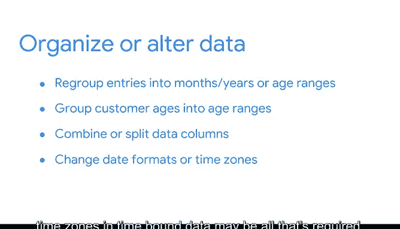

# 谷歌高阶数据分析3：《超越数字：将数据转化为洞察》go-beyond-the-numbers（中英双字） - P13：13_02_01_发现数据集中缺失的内容.zh_en - GPT中英字幕课程资源 - BV1Tz4y1t7PN

I've often found that stepping away from a challenging project and taking a break helps me find new perspectives on my work。

I like to get a can of seltzer from the fridge。 Take a walk and reflect on what I know and what I don't know about the project I'm working on。

The EDA discovering process requires a similar shift in perspective。

After I perform an initial discovering of a data， I have usually learned enough about the project to make a hypothesis based on that data。

A hypothesis is a theory or an explanation based on evidence that is not yet proved true。

Data professionals often use hypotheses as a starting point for continued investigation or testing。

Once I form my hypothesis， I'm in a better position to discover more about the data and achieve my ultimate goal。

 telling a story。 so far in this course， we've discussed how to begin the discovering practice of ED。

 You learned how to examine data sources， data formats and data types。

 You've considered column header information and averages。

 and you've made some initial visualizations to represent your data。

You use Python to determine the size and scope of the data and learn when you need to ask the owner of the data clarifying questions。

After you've made sense of the raw data， you're ready for the next step of the discoverying process。

 drafting a list of questions and forming hypothesis。In this video。

 you will learn how to ask meaningful questions about the goal you've outlined in the pace workflow to better understand what is missing from your data and what you still need to find out。

One way I like to do this is by breaking the original problem into smaller chunks。

 Some questions you might ask include， how can I break this data into smaller groups so I can understand it better。

How can I prove my hypothesis or in its current form， can this data give me the answers I need？

Let's consider these questions in context， for example。

Imagine you work as a data analyst for an international airline。

 and you need to determine whether lowering the prices of tickets will attract more customers in certain days of the week。

To solve this problem， you might ask， which months have the most passenger traffic， which weeks。

 dates or known holidays have the highest number of passengers？When are tickets typically purchased？

Then you'd form your hypothesis In this case， your hypothesis might be I predict that Tuesdays and Wednesdays of a normal business week have the fewest number of passengers and flights。

 so if the airline lowers prices for Tuesdays and Wednesdays during on holiday weeks。

 then they will sell more tickets。😡，Eventually， you would test your hypothesis by analyzing the data to understand whether the airline would attract more customers by lowering the prices on those specific flights。

The purpose of asking questions and forming a hypothesis is to better understand what you want to learn from the data and what the results of your testing might show。

Later， when you're performing other practices of EDA。

 you can refer to these questions and your hypothesis to determine whether you've supported or refuted your original theory。

To answer the questions and test the hypothesis you or your team formed， you will need a plan。

For instance， you might need to contact the subject matter expert who owns the database or is more familiar with a data source。

 or you may need to do your own research。In other words， leave no stone unturned。

It's an old saying about an ancient Greek legend， and it means to search everything you can to think of。

 to find what you're looking for。If you discover that your search for answers only brings more questions。

 that's a good thing， you're eliminating the possibility of misinterpreting or misrepresenting the data each time you learn more。

😡，At some point， you may need to decide you need to organize or alter the data to find the answers to your questions。

 for example。😡，You may need to regroup entries into months or years rather than days or weeks。

 or you might want to group customer ages into age ranges to help you understand trends more effectively。

😡，Sometimes combining or splitting data columns will be necessary for creating models to answer questions。

 other times， changing date formats or time zones in time bound data may be all that's required。😡。

For example， in your work with the International airlineline。

 you were tasked with finding days to enact lower ticket prices so the airline could attract new passengers。

Imagine the data you were given listed ticket prices in US dollars。

 but the original request was to lower ticket prices for passengers departing from Europe。

One change you would need to make immediately is to convert US dollars to Euros making small changes to your data like formatting the time。

 changing a unit or converting the currency is all part of the discovery process， however。

 with every change you make， stay focused on the problem you assigned or the plan that you established as part of the PA framework。

As we discussed， every data set is different， Asking questions and forming a hypothesis will take time and effort。

 but ultimately， answering questions and testing your hypotheses will be the way you find the stories hidden in your data。

😡，If you get stuck， it might help to step away from your initial discoverying work and think through your questions and hypotheses again。

 any visualization rendered。Conversion made， questions answered or hypothesis tested must be true to that data set story。

Who knows？ Maybe you'll find the answer on your walk break。 And wouldn't that be refreshing。

