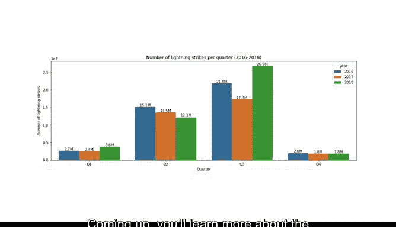

# 谷歌高阶数据分析3：《超越数字：将数据转化为洞察》go-beyond-the-numbers（中英双字） - P14：14_02_03_Python日期字符串操作.zh_en - GPT中英字幕课程资源 - BV1Tz4y1t7PN

As a data professional， you can expect to work with datetime objects and date strings。In this video。

 we'll continue coding in Python and practice converting， manipulating， and grouping data。

By the end of this video， we will create a widely used data visualization。

 a bar graph that tells a story with your data。Working with date strings will often require breaking them down into smaller pieces。

Breaking date strings into days， months， and years allows you to group and order the other data in different ways so that you can analyze it。

Manipulating date and time strings is a foundational skill in EDA。In this video。

 you will learn to convert date strings in the NoOAA Lightning strike dataset set into date time objects。

We will discuss how to combine these data objects into different groups by segments of time。

 such as quarters and weeks。Let's open a Python notebook and I'll show you what I mean。

Let's begin by importing Python libraries and packages to start， import Maplloot Lib and Padas。

 which you've used before。To review， pieplot is a very helpful package for creating visualizations like bar。

 line， and pie charts。Pands is one of the more popular packages in data science because its specific focus is a series of functions and commands that help you work with data sets The last package Cborn may be new to you Seaborn is a visualization library that is easier to use and produces nicer looking charts。

For this video， we'll use the NOAA Lightning strike data for the years 2016， 2017。

 and 2018 to group lightning strikes by different time frames。

This will help us understand total lightning strikes by week and quarter。

As I mentioned at the beginning of this video， when manipulating date strings。

 the best thing to do is to break down the date information like day， month and year into parts。

This allows us to group the data into any time series grouping we want。Luckily。

 there's an easy way to do that， which is to create a datetime object。Now。

 as you'll recall from a previous video， this NoOAA data has three columns giving us the date。

 number of lightning strikes， and latitude and longitude of the strike。

For us to manipulate the date column in its data， we'll first need to convert it into a date time data type。

We do that by simply coding DF date and making that equal to PD dot to date time with DF date input in parentheses。

Doing this conversion gives us the quickest and most direct path to manipulating the date string in the date column。

 which currently is in the format of a four digit year followed by a dash， then the two digit month。

 a dash， and lastly the two digit day。Okay。This is the exciting part。

Because our dates are converted into pandas datetime objects。

 we can create any sort of date grouping we want。Let's say， for example。

 we want to group the lightning strike data by both week and quarter。

All we would need to do is create some new columns。You'll see here we are creating four new columns。

 week， month， quarter and year， with the first line of code。

 we're creating a column week by taking the data in the date column and using the function STRF time。

😡，This function from the datetime package formats are datetime data into new strengths。😡。

In this case， we want the year followed by a dash and the number of weeks out of 52。

If we want that string， we need to code it as percent sign， y， dash， W， percent sign V。

The percent sign is the command which tells the date time format to use the year data in the string。

 the W implies this is a week and the V stands for value as in a sequential number running from 1 to 52。

The final string output for the column data will be in this format。2016 W27。

 The next line of code gives us the new month column。The argument is then written as percent sign， y。

 dash， percent sign M。This will output the four digit year followed by a dash。

 then the two digit month， essentially we're removing the last two digit date from the original date string。

Next， we will create a column for quarters， in this case， a quarter is three months。

Many corporations divide their financial year into quarters。

 so knowing how to divide data into quarter years is a very useful skill。In this case。

 it only takes one line of code。We'll call the new column quarter and we'll use our date column with two。

Underscore period。To create the quarter column。The datetime package has a premade code for dividing datetime into quarters。

In the two underscore period argument field， we only need to place the letter Q。After that。

 we can use the function STRF time to complete the string。For the argument， we put percent sign。

Y dash Q percent sign。Lowercase Q。The first Q is placed into the string to indicate we are talking about quarters。

 The percent sign followed by the lowercase queue indicates to pandas that we want the date formatted into quarters。

 Our final column will be the easiest to code to them all。

The year column is created by taking our original date column data and creating a string that includes only the argument percent sign y。

This creates a column of data with it with only the year in it。

Now that we have formatted some strings， let's quickly review our work by using the head function we learned in the previous video。

When we run this code， our four new columns are there， week， month， quarter， and year。😡。

They are all formatted just as we discussed。We can use these new strings to learn more about the data。

 for example。Let's say we want to group the number of lightning strikes by weeks。

An organization whose employees primarily work outdoors might be interested in knowing the week to week likelihood of dealing with lightning strikes。

In order to do that， well want to plot a chart。We've reviewed a couple of charts coded in Python by now。

 next， let's code a chart with the lightning strike data。

For plotting the number of lightning strikes per week， let's use a bar chart。

Our graph would be a bit confusing using all three years of data。

 so let's just use the 2018 data and limit our chart to 52 weeks rather than 156 weeks。

We can do this by creating a column that groups the data by year and then orders it by week。

We will then learn more about the structuring function in another video。For now。

 let's focus on plotting this bar chart。We'll use the PLT dot bar function to plot。

Within our argument field， we select the x axis， which is our weak column。Then the y axes or height。

 which we input as number of strikes。Next， we'll fill in some of the details of our chart。Using PLT。

 plotot， we will place arguments in the X label， Y label， and title functions。😡。

The arguments are weak number。Number of lightning strikes and number of lightning strikes per week。

 2018， respectively。This renders a graph， but the X axes labels are all joined together。

So we have a chart。But the X axis is difficult to read， so let's fix that。

We can do that with the PLT dot X ticks function。For the rotation。

 we can put 45 and for the font size， let's scale it down to eight。After we use PLT。t show。

 the X axes labels are much cleaner。Given our bar chart illustrating lightning strikes per month in 2018。

 you could conclude that a group planning outdoor activities for weeks 32 to 34 might want a backup plan to move indoors。

Of course， this is a broad generalization to make on behalf of every North American location in the data set。

 but for our purposes and in general， it is a good understanding of our data to have。

For our last visualization， let's plot lightning strikes by quarter。For visualization。

 it will be far easier to work with numbers in millions， such as 25。2 million rather than。25154，365。

 for example。Let's create a column that divides the total number of strikes by 1 million。

We do this by typing DF by quarter and entering the relevant column in the argumentsments field。

In this case， we want number of strikes。Next， we add on dot。😡，DIV to get our division function。

Lastly， for the argument field， we enter1 million。When we run this cell。

 we have a column that provides the number of lightning strikes in millions。Next。

 we'll group the number of strikes by quarter using the group by and Re index functions。

This code divides the number of strikes into quarters for all three years。

Each number is rounded to the first decimal。The letter M represents 1 million。

As you'll soon discover， this calculation will help with the visualization。

You'll learn more about these functions in another video。

We will plot our chart using the same format as before we use the PLT。

t bar with our X being from our DF by quarter data frame with quarter in the argument field。😡。

For the height， we put the number of strikes column in the argument field。

It would be helpful if each quarter had the total lightning strike count at the top of each bar。

To do that， we need to define our own function， which we will call add labels。Let's type add labels。

 then input our two column axes， quarter and number of strikes separated by columns and brackets。

At the end， we use the format we created earlier， number of strikes formatted to label the number of strikes by quarter。

To finish the bar chart， we labeled the X and Y axes and add the title。

Before we show the data visualization， there are a few small things we want to add just to make it more friendly to read。

Let's set our length and height。To 15 by5。Next， let's make the bar labels cleaner by defining those numbers and centering the text。

Our bar chart now gives us the number of strikes by quarter from 2016 to 2018。

To make the information easier to digest， let's do one more visualization。

Here is the code for plotting a bar chart that groups the total number of strikes year over year by quarter。

Review the code carefully and consider what each function and argument does in order to create this final polished bar chart。

Each year is assigned its own color to highlight the differences in quarters。

And now we have our chart。

Coming up， you'll learn more about the different methods for structuring data， I'll see you there。

