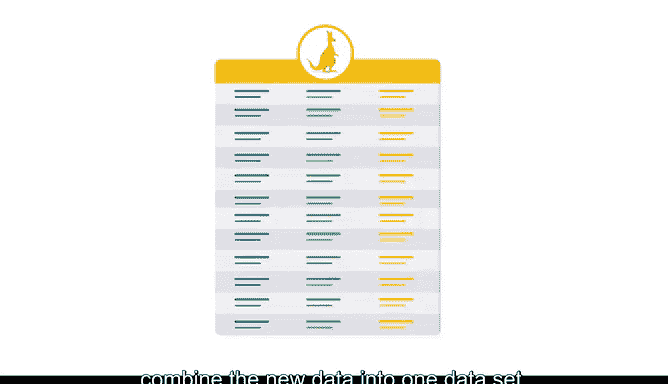

# 谷歌高阶数据分析3：《超越数字：将数据转化为洞察》go-beyond-the-numbers（中英双字） - P15：15_02_01_运用结构化方法建立数据秩序.zh_en - GPT中英字幕课程资源 - BV1Tz4y1t7PN

As a data analytics professional， you will often need to learn more about your data sets。

 This is where the structuring practice of EDA can help。

Let's explore the valuable methods that are part of this practice。

As you'll recall from earlier in the program， structuring helps you to organize， gather， separate。

 group， and filter your data in different ways to learn more about it。😡，Next。

 we'll talk about the methods involved in structuring。

 and later you'll practice these concepts using Python。First on the list。

 the structuring methods is sorting。Sorting is the process of arranging data into meaningful order。

Imagine that you're given a data set about kangaroos。

These furry creatures are native to Australia and Papua New Guinea。

 They're known for their strong tails and belly pouch they used to cradle their babies called Joeeys。

The kangaroo dataset contains information about kangaroo characteristics like pouch size。

 tail length， total body length， and much， much more。

The first data we'll consider is a data column measuring the volume of the kangaroo pouches in cubic centimeters。

We can sort those values in ascending or descending order from biggest to smallest or smallest to biggest another useful structuring tool is extraction。

Extracting is the process of retrieving data from a data set or source for further processing。

You can think of extraction as retrieving whole columns of data。

An example of extraction is to take the kangaroo data from before。

 then evaluate just two of the columns from the data sets such as pouch volume and tail length。

You can use the resulting data for analysis， comparisons or visualization。

Another structuring method is filtering。Filtering is the process of selecting a smaller part of your data set based on specified parameters and using it for viewing or analysis。

😡，You can think of filtering as selecting rows of a data set。In the case of our kangaroo data。

 filtering can look like viewing only the kangaroo pouches of kangaroos that also have tails shorter than 1 mter。

This is useful in finding meaningful groups or trends in the data。

Next on the lists of structuring methods is slicing。

Slicing breaks information down into smaller parts to facilitate efficient examination and analysis from different viewpoints。

Think of slicing as an either or both options for columns and rows。

A combination of extraction and filtering。In the Kangaroo data。

 let's say you have a column of their body length called total body length。In another column。

 you have the kangaroos identified as one of the three different regional populations。

If you were to take the body length of only one of the three regional populations。

 you would be pulling a slice of the data。Grouping is our next structuring method。😡，Grouping。

 sometimes called bucketizing， is aggregating individual observations of a variable into groups。

An example of grouping is to add a new column called To body length next to the kangaroo tail length column。

Then group all the tail length into three types， long。

 average and short based on the measurements in the tail length column。

You can now find and organize the total body length values based on the kangaroo tail length groups。

The last structuring method is merging。Mering is a method to combine two different data frames along a specified starting column。

For example， imagine we had an additional data set of kangaroo information from a different field study。

 but with the same parameters and variables， we might use the merge or join functions to align the columns and combine the new data into one dataset set。

It's essential that you do not change the meaning of the data while performing your filtering。

 sorting， slicing， joining， and merging operations。😡，If， for example。

 we did not merge the kangaroo pouch measurements correctly with their matching kangaroo name and ID。

 the data would not be representative and our analysis would be far less than useful。

Being true to the data is being true to its story。Hopefully。

 you are beginning to understand the value of organizing and structuring data in order to analyze it。

😡，Coming up， we will practice structuring using Python。

