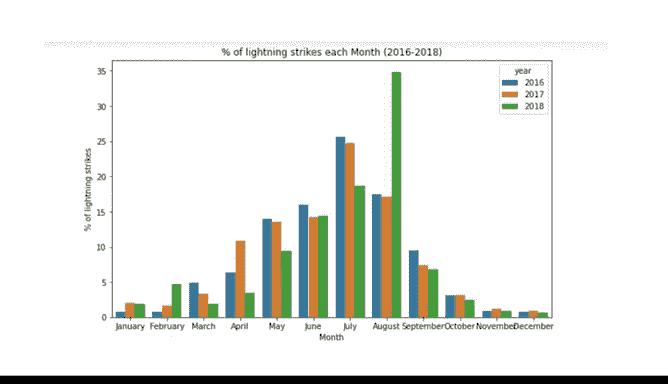

# 谷歌高阶数据分析3：《超越数字：将数据转化为洞察》go-beyond-the-numbers（中英双字） - P16：16_02_03_Python实现EDA结构化.zh_en - GPT中英字幕课程资源 - BV1Tz4y1t7PN

You've learned about how structuring data can help professionals analyze， understand。

 and learn more about their data。Now let's use a Python notebook and discover how it works in practice。

We'll continue using our NoOAA Lightning strike data set。For this video。

 we'll consider the data for 2018 and use our structuring tools to learn more about whether lightning strikes are more prevalent on some days than others Before we do anything else。

 let's import our Python packages and libraries。These are all packages and libraries you're familiar with。

 pandas， nuumpy， Seaborn， datetime， and mappllootlibib。piplloot。For a quick refresher。

 let's convert our date column to date time and take a look at our column headers We do this to get our dates ready for any future string manipulation we may want to do and to remind us of what is in our data。

As you remember， there are three columns in the data set， date， number of strikes。

 and center point GeM， which you'll find after running the head function。Next。

 let's learn about the shape of our data by using the DF shape function。When we run this cell。

 we get 3，401，012 comma3。Take a moment to picture the shape of this data set。

We're talking about only three columns wide and nearly three and a half million cells vertically。

That's incredibly long and thin。We'll use a function for finding any duplicates。

When we enter DF dot D underscore duplicates with an empty argument field followed by dot shape。

 the notebook will return the number of rows and columns remaining after duplicates are removed。😡。

Because this returns the same exact number as our shape function。

 we know there are no duplicate values。Let's discuss some of those structuring concepts we learned about earlier。

Let's start with sorting。We'll sort the number of strikes column in descending value or most to least。

While we do this， let's consider the dates with the highest number of strikes。We'll input Df sort。

Underscore values。Then in the argument field， type pi， then the equal sign。Next。

 we input the column we want to sort number of strikes followed by ascending equal sign false。

If we add the head function to the end， the notebook outputs the top 10 cells for us to analyze。

We find that the highest number of strikes are in the lower 2000s。

It does seem like a lot of lightning strikes in just one day。

 but given that it happened in August when storms are likely， it is probable these 2。

000 plus strikes were counted during a storm。Next， let's look at the number of strikes based on the geographic coordinates。

 latitude and longitude。We can do this by using the value underscore counts function。We type in DF。

 followed by the center point GM。Then we type in dot value underscore counts with an empty argument field。

Based on a result， we learned that the locations with the most strikes have lightning on average。

 every one in three days， with numbers in the low 100s。Meanwhile。

 some locations are reporting only one lightning strike for the entire year of 2018。

We also want to learn if we have an even distribution of values or whether 108 is a notably high value for lightning strikes in the US。

To do this， copy the same value counts function， but input a colon 20 in the brackets so that you can see the first 20 lines。

The rest of the coding here is to help present the data clearly。

We rename the access and index to unique values and counts respectively。Lastly。

 we'll add a gradient background to the counts column for visual effect。After running the cell。

 we discover zero notable drops in lightning strikee counts among the top 20 location。

This suggests that there are zero， notably high lightning strike data points。

And that the data values are evenly distributed。Next， let's use another structuring method， grouping。

You'll often find stories hidden among different groups in your data。

 like the most profitable times of day for a retail store， for instance。For this data set。

 one useful grouping is categorizing lightning strikes by day of week。

 which will tell us whether any particular day has fewer or more lightning strikes than others。

Let's first create some new data columns。We create a column called week by inputting Df。t date。 dt。

iso calendarendar。Let's leave the argument field blank and add a dot week at the end。

This will create a column assigning numbers 1 to 52 for each of the days in the year 2018。

Let's also add a column that names the weekday。Type in Df。t date。 dt。 day underscore name。

Leaving the argument field blank。For this last part， let's input D F dot head again。

You'll discover the dates now have week numbers and assigned weekdays。We have some new columns。

 so let's group the number of strikes by weekday to determine whether any particular day of week has more lightning strikes than others。

Let's create a data frame with just the weekday and number of lightning strikes We'll do this by inputting DF double bracket。

 weekday comma， number of strikes， both in single quotes， followed by more double brackets。Next。

 we'll add one of our structuring functions grouped by。

 followed by weekday do mean within the argument field。

What we're telling the notebook here is to create a data frame with weekday and number of strikes。

 but then also group the total number of strikes by day of the week。

 giving us the mean number of strikes for that day。To understand what this data is telling us。

 let's plot a box plot chart。A box plot is a data visualization that depicts the locality， spread。

 and skew of groups of values within quartiles。For this data set and notebook。

 a box plot visualization will be the most helpful because it will tell us a lot about the distribution of lightning strike values。

Most of the lightning strike values will be shown as grouped into colored boxes。

 which is why this visualization is called a box plot。

The rest of the values will string out to either side with a straight line that ends in a T。

We will discuss more about box plots in an upcoming video Now before we plot。

 let's set the weekday order to start with Monday。Now to code that input G equals sign SN S dot box plot。

Next， in the argument field， let's have x equal weekday and y equal number of strikes。For order。

 let's do weekday order and for the show Fers field， let's input false。

Show Fers refers to outliers that may or may not be included in the box block。

If you input true outliers are included。 if you input false。

 outliers are left off the box plot chart。Keep in mind。

 we aren't deleting any outliers from the data set when we create this chart。

 we're only excluding them from our visualization to get a good sense of the distribution of strikes across the days of the week。

Lastly， we will plug in our visualization title， Lightning Dis per weekday for 2018 and click Runsell。

Now you'll discover something really interesting。The median。

 indicated by these horizontal black lines， remains the same on all of the days of the week。

As for Saturday and Sunday， however， the distributions are both lower than the rest of the week。

Let's consider why that is。What do you think is more likely that lightning strikes across the United States take a break on the weekends？

Or that people do not report as many lightning shrugs on weekends。While we don't know for sure。

 we have clear data suggesting the total quantity of weekend lightning strikes is lower than weekdays。

 we've also learned a story about our data set that we didn't know before we tried grouping it in this way。

Let's get back into our notebook and learn some more about our lightning data。

One common structuring method we learned about in another video was merging。

 which you'll remember means combining two different data sources into one。

We'll need to know how to perform this method in Python if we want to learn more about our data across multiple years。

 Let's add two more years to our data 2016。In 2017。To merge three years of data together。

 we need to make sure each data set is formatted the same。

The new data sets do not have the extra columns week and week day that we created earlier。

 so to merge them successfully， we need to either remove the new columns or add them to the new data sets。

There's an easy way to merge the three years of data and remove the extra columns at the same time。

Let's call our new data frame union underscore DF。We'll use the pandas function conca to merge or more accurately concatenate the three years of data。

Inside the concat argument field， we'll type in Df。td to pull the weekday and week columns out。

We also input the axis we want to drop， which is one。Lastly， and most essentially。

 we add the data frame name we are concatenating to DF underscore2。

We also input true for ignorere index because the two data frames will already align along their first columns。

And now you've just learned to merge three years of data。

To help us with the next part of structuring， create three date columns following the same steps you used previously。

We've already added the columns for year， month， and month underscore text to the code。

Now let's add all the lightning strikes together by year so we can compare them。

We can do this by simply taking the two columns we want to look at year and number of strikes and group them by year with the function dot sum on the end。

You'll find that 2017 did have fewer total strikes than 2016 and 2018。

Because the totals are different， it might be interesting as part of our analysis to see lightning strike percentages by month of each year。

So let's call this Lightning by month， grouping our union data frame by month， text， and year。

Additionally， let's aggregate the number of strikes column by using the pandas function named Ag。

In the argument field， we place our column name。😡，And our aggregate function equal to sum so that we get the totals for each of the months in all three years。

When we input the head function， we have the months in alphabetical order。

 along with the sums of each month。We could do the same aggregation for year and year strikes to review those same numbers we saw before with 2017 having fewer strikes than the two other years。

We created those two data frames， lightning by month and lightning by year in order to derive our percentages of lightning strikes by month and year。

We can get those percentages by typing lightning by month dot merge with lightning by year comma on equal sign year in the argument field。

You'll find that the merge function is merging lightning by year into our lightning by month data frame。

 according to the year。Lastly， we can create a percentage lightning per month column by dividing the percentage lightning dot number of strikes by percentage lightning。

 after which we'll add the asterisks 100。To give us percentage。Now， when we use our head function。

 we have a restructured data frame。To more easily review our percentages by month。

 let's plot a data visualization。For this one， a simple grouped bar graph will work well。

We'll adjust our figure size to 10 and6 first。Then we use the Seabornne Library bar plot with our X axis as month text and our Y axis as percentage lightning per month。

For some color， we'll have our hue change according to the year column with the data following the month order column。

Finally， let's input our X and y labels and our title and run the cell。

When you analyze the bar chart， August 2018 really stands out。In fact。

 more than one third of the lightning strikes for 2018 occurred in August of that year。

The next step for a data professional trying to understand these findings might be to research storm and hurricane data to learn whether those factors contributed to a greater number of lightning strikes for this particular month。

Now that you've learned some of the Python code for the EDA practice of structuring。

 you'll have time to try them out yourself。Good luck finding those stories about your data。

