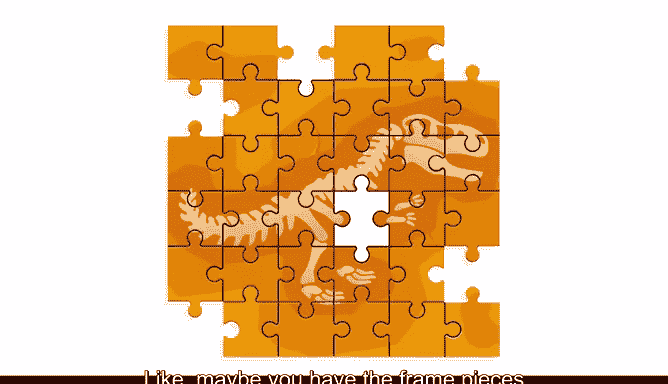
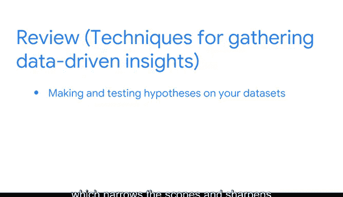

# 谷歌高阶数据分析3：《超越数字：将数据转化为洞察》go-beyond-the-numbers（中英双字） - P17：17_02_01_总结回顾_2.zh_en - GPT中英字幕课程资源 - BV1Tz4y1t7PN

You know that moment in the puzzle building process when you're starting to see the full picture take shape。

 like maybe you have the frame pieces connected， but still the way to go。

So far you've learned about some practices of EDA， you've learned how to gather， analyze。

 organize and structure data Com up， you will continue to put these pieces together and the picture will become clear。

You're making great progress。 You've learned about the data sources。

 data types and data formats and the importance of knowing the basics about your data。

We've worked through how to use Python to uncover big picture understandings of your data sets。

 like column headers。D types， size and shapes， as well as basic visualizations。

Along with these parts of EDA and discovering， we've learned about date and time transformations in Python。

As for the EDA practice of structuring， you've learned to make order from chaos with functions like sorting。

 extracting， filtering， slicing， joining， merging， and grouping。😡，In Python。

 you practice applying these functions to data sets that are similar to those you might work with in your career as a data professional。

Data professionals commonly use each of these concepts。

 You will continue to build your skills with them as you search for the stories hidden in data。

As a data professional， I can say that cleaning and organizing your data set is 90% of the battle。

 and once you've structured your tables， uncovering insights and trends can be like a walk in the park。

I mentioned earlier how I used to work as a data analyst in healthcare consulting and would analyze vast amounts of medical record data to help recommend treatments for patients with severe illnesses。

Typically， data is hosted across multiple different sources and tables。

 making them difficult to merge together plus， medical records may be organized so that medications a patient took and their corresponding conditions are separated。

 so in order for me to understand what type of treatment a patient took for which illness。

 the side effects they experienced and whether the treatment worked。

 I had to merge hundreds of tables together。Once I did。

 it was incredibly easy for me to compare and contrast the different types of treatments taken and its impact on each patient。

You started to learn the skills needed to complete similar tasks along the way。

 you also learned some key workplace skills like the timing for communicating updates and posing questions to project stakeholders。

 managers and subject matter experts。😡，We also talked about making and testing hypotheses on your data sets。

 which narrows the scopes and sharpens the detail of your data driven stories。

In short， you are understanding more and more what it means to perform EDA on a data set。😡。

Great work。Later in the program， we'll discuss how to put together the rest of the data story by learning what to do with missing data and outliers。

 as well as making and using visualizations to help tell that story。😡，I'll meet you there。

