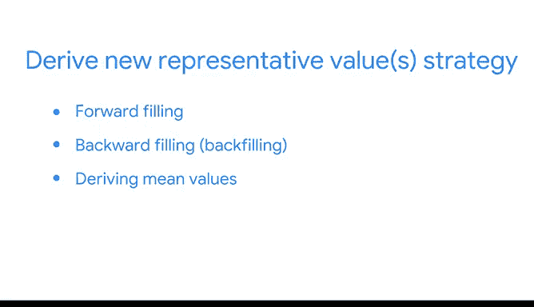

# 谷歌高阶数据分析3：《超越数字：将数据转化为洞察》go-beyond-the-numbers（中英双字） - P19：19_03_02_缺失数据处理方法.zh_en - GPT中英字幕课程资源 - BV1Tz4y1t7PN

Remember earlier when you imagined yourself as a quality assurance manager at a company assembling a board game？

When you discovered that the machine that produces the games was having technical issues and causing game boxes to have pieces missing。

 you and your company could have chosen a different number of paths forward。 One。

 you could have thrown away the impacted game boxes。2。

 you could have left them as is and sold them at a discounted rate or three。

 and the one you chose in the example， you rummged through the boxes and corrected the mistakes。

There was a plan， strategy， or protocol for dealing with missing pieces。

The same should be true for any missing values you find in a data set。

When you have missing entries in your data， you have to decide on a plan for dealing with them。

Even more than that， you must be ready to communicate with stakeholders if missing values impact your analysis。

 missing data， which is often encoded as a N A， na or blank。

 is defined as a value that is not stored for a variable in a set of data。

 This is different from a data point of 0。 I'll explain more on that in a bit。

Data professionals often experience the challenge of missing data。Every data set is different。

 so there are a wide variety of reasons for values to be missing。

 Everything from a computer error during a data upload to someone simply forgetting to input it。

Depending on the number of entries in your data set and the quantity of missing values。

 the impact of data fields with a not a number or NNs can range from negligible to substantial。

The impact will also determine how you communicate to stakeholders or clients ranging from a note at the bottom of a data visualization about the fact that there's missing data to a face to face meaning about how analyses cannot be completed due to the large number of missing values。

Here's an example of the impact missing data has on a data set and the ethical questions missing data creates。

Imagine you're a data professional trying to learn more about sleep habits。

You email a questionnaire to， say， 100 people and all of them complete it。One of the questions asks。

 do you sleep exactly 8 hours each night。The answer choices are yes， no or unsure 9 people answer。

 Yes，9 answer。 no and 15 answer unsure。Because only 33 people responded to that question。

 it's hard to draw a definitive conclusion about the sleep habits of all 100 students。

Since 100 people completed the questionnaire and only 33 responded to this question。

 67% of their replies would be considered missing。These missing values greatly impact the question's resulting data。

It would be unwise for a data professional to try to use the 33% response rate in order to draw conclusions about the entire population。

If you can encounter this level of missing values while working as a data professional。

 you should communicate the inability to complete any analysis and suggest possible solutions。

Another challenge that can come up during E DA is with the value0 in some data sets。

 a0 could be considered a missing value， but in other dataset sets could be a legitimate data point。

In some data sets， a nan or blank space might be a mistake， someone forgot to fill it in。

Or the data may have been left blank because the column may not apply to that data point。😡。

Data professionals， unsure of whether or not the blank space is intentional。

 should ask a stakeholder or the owner of the data to confirm the space's legitimacy。

Whenever you find missing data， you have a choice to make on how to handle it。As a data professional。

 you should consider how the missing data might impact stakeholders and who should be made aware。

Here are four common ways to handle missing data。1。

 you requested the missing values be filled in by the owner of the data 2。

 you delete the missing columns， rows or values， which would work best if the total count of missing data is relatively low。

3， you create a N category or 4， you derive new representative values such as taking the median or average of the values that aren't missing。

 First， we'll talk about filling in the missing data。

 If there are large quantities of missing values in the data you receive。

 the best method to handle the missing data would be to contact the owners of the data and request that that data be filled in。

For example， in our sleep example， you could send a follow up request for people to log a response to that particular question。

 or you could rephrase the question， how many hours do you sleep each night？However。

 in many data sets， you'd see while working as a data professional。

 the option to get missing data filled in may not be feasible for a variety of reasons。 For example。

 if you're working on a project that is time sensitive。

 you might not have time to gather more data before your deadline。

Or the data cannot be retrieved because the study happened too long ago。

 If filling in missing data isn't an option， you can also choose the option of deleting the missing data。

 though some might assume it's not appropriate to delete data removing rows or whole columns of data is ideal if there isn't a large percentage of Ns or the values are not going to impact the business plan for the data。

 One thing to watch out for， though， is discarding missing data that is not missing at random。

Deleting values that have been left blank intentionally can skew the results of your analysis。

 For example， in the S questionnaire， if you were to remove all the people that left that question blank。

 you delete a majority of the data。 A third option is to make the Ns their own category。

 which is a good strategy if the missing data itself is categorical rather than numerical。

 For example， and the sleep questionnaire， If you were to put all the nonres into their own category called answer。

 not recorded， you would be creating a category for the missing data。 Finally。

 there is the strategy of filling in the missing data by creating a representative value。

 this strategy can be more useful with business plans that call for a predicted value or forecast。

 there are multiple methods within this filling in strategy to choose from。

 including the foremost common forward filling backward filling derived。

Mean values and deriving median values。 We will talk about how to do all these missing data operations using Python in another video。

 These are the most common methods for handling missing data。

Choosing which method to use comes with experience， intuition and reasoning。

Sometimes you'll have the opportunity to use more than one option with the data set。

Every data set and project plan will be different， so you will be making this determination each time you encounter new data。

Sometimes you'll want to confer with peers or managers or stakeholders in order to make a decision。

The impact missing values has on your analysis should be the determining factor in whom you should contact。

As a data professional， it is essential that you are thoughtful and intentional about how missing data are addressed。

Consider the quantity of NanNs and their importance in relation to the project plan， ask yourself。

 how will this approach impact this data set？And what are the ethical consideration？

Just like the board game scenario， it is essential to determine a strategy and decide on a plan。

