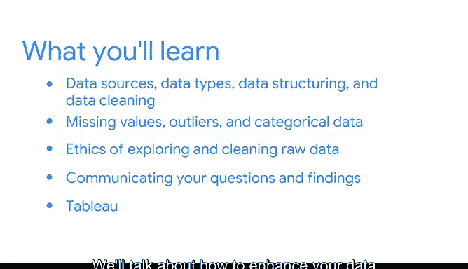

# 谷歌高阶数据分析3：《超越数字：将数据转化为洞察》go-beyond-the-numbers（中英双字） - P1：01_01_01_课程3简介.zh_en - GPT中英字幕课程资源 - BV1Tz4y1t7PN

Imagine you're an archaeologist， someone who unearths artifacts to study ancient civilizations and preserve the stories of history。

You're excited because you're the first person to explore a new D site。

The rising sun creates a warm glow on the orange and yellow rock of the ancient riverbed in front of you。

You forget your early morning tiredness and yesterday's 15 hour flight as you breathe in the crisp clean air。

 you pause as you remember the words of your sight leader the previous evening。

This spot has never been studied， but it's absolutely perfect for preservation。

 You're guaranteed to find something and anything we find will be able to present at the International Archaeological Research Institute next summer。

😊，What could be hidden under that rock？What ancient mysteries will be uncovered。

 what stories will be on earth？The possibilities seem endless。Hi there。 My name is Rob。

 I'm a consumer product marketing leader， I work on marketing projects here at Google and every time I get the opportunity to analyze data。

 it feels like I could be an archaeologist on the verge of an incredible discovery。

Some people see a data sheet or a table of disorganized numbers and they think，ughh， this is so lame。

 but data professionals know better， don't we， we know that hidden inside the numbers。

 columns and rows are golden nuggets of information， never before seen insights or compelling trends。

These interesting bits of hidden knowledge are stories waiting to be shared。

 and stories are one of the most impactful ways to communicate ideas。The amazing truth for us。

 data professionals， is that all data has stories to tell。

So whether you're an aspiring data professional or you want to learn to tell a good story。

 preferably both， welcome to this course。😡，By now， you have a fairly good idea the scope of this program and the basics of Python coding。

 Now it's time to dig deep into unexplored data and try to make sense of it。

 Are you ready to explore。😊，We will begin with how to find and sculpt stories using a six part process called Exploratory data analysis。

 then we'll discuss how pace applies to telling stories using data。

Do you remember the data professional workflow acronym Pa that is plan， analyze。

 construct and execute We'll talk about how PA applies to exploring data and learn about the necessity of visualizations in understanding the data Finally。

 I'll show you how to perform exploratory data analysis on a data set in Python expanding on those Python skills you learned previously。

Later in this course， you'll learn about data sources， data types， data structuring。

 and data cleaning。Using Python notebooks， we'll discuss how to work with missing values， outliers。

 and categorical data。We'll talk about the ethics of exploring and cleaning raw data and how to communicate your questions and findings to various audiences。

Later in this course， you'll learn more about the visual analytics platform Tableau we'll talk about how to enhance your data story with visuals and presentations。

Along the way， I'll share tips on shaping your data stories for different audiences。

 like how to build data visualizations that target an audience's needs。

Data professionals at Google identify the essential skills that are fundamental to working in data Throughout this course。

 there will be opportunities to practice finding and telling stories with data。 In short。

 stories can change lives。And data driven stories are particularly compelling because they are based in numbers。

They can also communicate principles， concepts， cautions， and new ideas to others。

To give you an example for my own life， I actually started my career as a data analyst for a healthcare consulting firm。

I was responsible for identifying and recommending the most effective treatments for patients with serious medical conditions。

 ranging from asthma to diabetes to cancer， to develop my recommendations I analyzed the medical records of millions of patients and compared and contrasted the outcomes。

 side effects and medical costs of each treatment through my findings。

 we were able to recommend treatments that would not only help these patients heal but also help improve their quality of life and reduce their medical bills。

The stories are out there just waiting to be found。

 so get out your shovels and magnifying glasses and let's start exploring。

