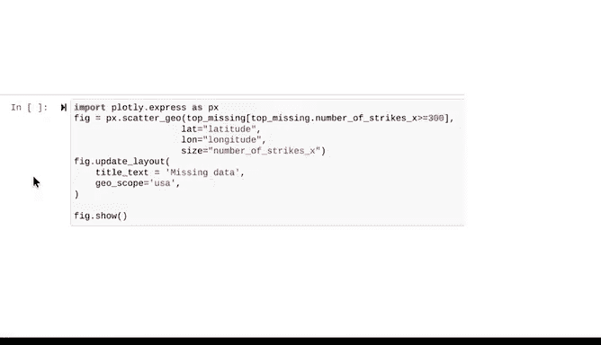

# 谷歌高阶数据分析3：《超越数字：将数据转化为洞察》go-beyond-the-numbers（中英双字） - P20：20_03_04_Python笔记本中的缺失数据实操.zh_en - GPT中英字幕课程资源 - BV1Tz4y1t7PN

Now that we reviewed the importance of having a plan to address missing data。

 let's talk about how to identify and decide how to work with missing data in a Python notebook。

We'll use the data you're familiar with the group of No OAA lightning strike dataset sets。

The goal of this video is to learn how to identify missing data。

You'll be provided two different slices of data from August 2018。

 one slice will have the columns date， Center point GM， latitude， longitude， and number of strikes。

The second slice of the data will include the same columns as the first slice along with the zip code。

 state， city， and state code。You will learn through comparisons of these two data sets。

 how to find missing data。Before we look for any missing values。

 we need to import some python libraries and packages。 We'll use pandas， numpy， seaborn。

 date time and Pi plot from matpl Lib。We will begin by looking at only the number of lightning strikes for August 2018。

Using less data in a Python notebook allows you to spend more time coding and less time waiting for the code to run。

For this exercise， our first data set will have two additional columns called latitude and longitude。

 which were points pulled from the center point GM column。

Let's explore the column headers and the overall size of this first data set using the functions that you're already familiar with。

 head and shape。We'll find the two additional columns we just mentioned for latitude and longitude。

 as well as a shape of 717530 rows and five columns。Let's put this aside as our first data frame。

 saved as DF。Next， we'll use the second data set for August 2018。This one has columns for zip code。

 which is a postcode delivery area number in the US as well as city， state。

 and a column titled state code that has two letter abbreviation of states in the US we'll call the second data frame Df zip。

 so we don't get confused with the first data set we created earlier。

Let's run the same two functions， head and shape on Df zip。

The head function returns what we expected out of the data set。The data columns， zip code， city。

 state， state code， Center point GO， and number of strikes。The shape function， however， returned 323。

700 rows and seven columns。Given that this data frame is also from August 2018。

 we expected to see the same number of rows as the first data frame， 717，530。To further explore this。

 let's put the two data frames together with the mergege function。

We'll need to create a new data frame， we'll call it Df joined。

 followed by an equal sign and DF dot merge。This DF dot merge indicates that we want to merge the first data frame we saved。

 named DF with another data frame。For the merge， put DF underscore zip in the argument field。

 which is the data frame we want to merge with DF。Next， fill in the parameters for the merge。

 including how equals left followed by a comma。Finally， input the last parameter。On equal sign。

 followed by two column names， date， and center point gion。These two parameters。

 how and on tell Python which way to join the data When we run the head function on our new data frame。

 we find Nans listed for the columns zip code， city， state， state code， and number of strikes Y。

Now that the data is merged， let's use a basic function we learned in a previous lesson to search for missing data。

 describe。Input DF， underscore， join dot， De， and leave the argument field blank。

When we run the cell， we find that the total count of lightning strikes has been divided into two。

Number of strikes X and number of strikes Y。Once we merged the two data frames。

 Padas automatically separated number of strikes into data entries with full data rows and data entries that have missing entries。

We can find the total amount of data that's missing using this next piece of code。

We'll create a data frame called DF nullGO by taking our join data frame， DF joined。

 and then adding the pandas function is null all one word。

The term null indicates that the data is missing。This function pulls all of the missing values from the DF join data frame。

We already know which of the columns have missing values。Since we're interested in finding the total。

 we can use any one of those columns。For this code， we selected state code。After that。

 we'll use the shape function to give us the total rows and columns， which comes to 393。

830 and10 respectively。For even more detail， use the info function， which we used in another video。

When we input D F joined do info with the argument field left blank。

 we get the column names and another column called non null count。

Non null count is the total number of data entries for a data column that are not blank。

A quick check of the non null count column helps us confirm which columns have missing data。Zip code。

 city， state and state code。In fact， if we subtract the total number of strikes X and the number of strikes Y。

 the result is the number we identified earlier。393830。

Let's take a look at the top portion of the new data frame we created。

 DF nullGO using the head function。The output tells us exactly what we expected it to find in the data frame we created。

In the top five lines of data， the columns zip code， city， state， state code。

 and number of strikes Y have the Nan values in the cells。

Now that we have pinpointed exactly what values are missing in our data frame。

 the last thing we'll do in this notebook is learn how these missing values impact our data。

The best way to do that is to create a data visualization。

A plotted map will help us see where the majority of the missing values are located geographically。

To design the map， let's start by creating another data frame。

 This one we'll call top underscore missing。With this data frame。

 we are gathering only the data comms we will need in order to plot a geographic visualization。

Latitude， longitude and number of strikes， X。As you'll recall from earlier in this video。

 number of strikes X includes all of the 717，530 data rows。

 while number of strikes Y are a segment of those 717，530 with missing data in the zip code。

 state and state code columns。You'll find that it's helpful to group the columns by latitude first。

 then longitude。This will make it easier for most data processors to plot。Lastly。

 we'll sort the Lightning Strs X column by sum of values。

And the ascending field we'll input false because we want the largest sums of lightning strikes at the top of the data frame。

Finally， let's take a look at what we built using the head function again。After running the cell。

 the first 10 rows show the most strikes are falling on and around the same latitudes and longitudes。

Let me give you a helpful hint before we plot a visualization using this data frame。

You should import the express package from plotly first。

Express is a helpful package that speeds up coding by doing a lot of the back end work for you。

If we don't use Express for this particular data set。

 which has hundreds of thousands of points to plot。

 your run cellll times could be long or the code could even break。Now it's time to create the map。

Our format for the graph will be from plotly Express called Sctter Geo。As indicated by its name。

 this graph type is used for scatter plots on a geographic map。In the argument field。

 we'll input the data frame we just created top missing。For the parameters in the argument field。

 we want to filter the number of values to be only those latitudes and longitudes with lightning strikes of more than 300。

Naturally， we plug latitude and longitude into their appropriate parameter spots。😊。

Then for the size parameter， we plug in the final column number of strikes x。Lastly。

 let's use the update layout function within the figure to give the plot title， missing data。

Now we create it。It's a nice geographic visualization， but we really don't need the global scale。

 Let's scale it down to only the geographic area that we are interested in。The United States。So。

Let's copy the same code we just wrote this time though。

 we add the parameter geo underscore scope equals USA。

This will limit the geographic scope to just the United States of America。

 then we can plot it again and check the output。

The resulting map shows a majority of these missing valley cropping up along the borders or in spots over bodies of water。

 like lakes， the ocean or the Gulf of Mexico。Given that the missing data were in the state abbreviations and zip code columns。

 it does make sense why those data points were left blank。There are no zip codes for bodies of water。

You'll also notice some other locations with missing data that are not over bodies of water。

These types of missing data， latitude， and longitude on landN are the kind of missing data you would want to reach out to the NoOAA about。

What's interesting about cleaning the lightning strike data and looking for missing data values is that we learn something new in the process we found one of the stories hidden in the data。

 the data values were missing because the lightning strikes were over water。

It goes to show you that data cleaning may sound tedious， but you'll never know what you learn。

