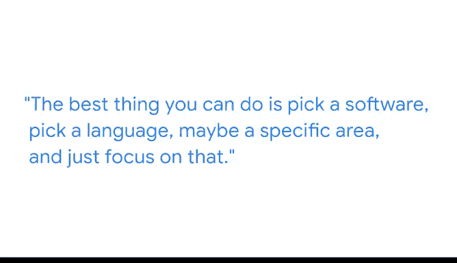

# 谷歌高阶数据分析3：《超越数字：将数据转化为洞察》go-beyond-the-numbers（中英双字） - P21：21_03_05_雷米-数据专业人员的日常.zh_en - GPT中英字幕课程资源 - BV1Tz4y1t7PN

Hi， my name is Remy and I'm a customer engineer for Google Cloud。

 a customer engineer is someone who focuses in some technical field for me it's data analytics and machine learning and is the expert in that field and helps their customer answer questions and build things related to data analytics I had no exaggeration around 30 different jobs before I got into the field that I'm currently in I was a cashier。

 a hostess， a cocktail waitress， an office assistant and quite frankly I wasn't very good at any of those jobs if something's like repetitive I can't concentrate and then I end up making silly mistakes so that's kind of what's so great about data science is a lot of the minutia and repetitive tasks as software does it for you where you can write a script to do it there is definitely no typical day in the life of a customer engineer usually I will start the day by looking at emails。

I'll usually have some kind of questions from a customer and another colleague related to data that I can help answer there's a lot of informational emails about new features。

 products or techniques I have to read those and learn about them because it's my job to be the person who knows about all of these things for our customers I'll also typically have a few meetings where I'm working with our account and customer teams where we kind of try to strategize how we're going to help customers and get them to do new things with our tools a new feature that I've been working with is related to our data warehouse BigQuery you can actually create machine learning models within Bigqueery so you don't have to move the data anywhere I have a variety of customers that use BigQury machine learning so I can now come to them and share with them this new feature and show them how it actually works and if while they're using it you know they might have an issue that comes up they get some kind of error。

Error I can help troubleshoot that problem for them There's so much going on in this field of data and it's also new it's going to feel overwhelming I've been doing it for almost a decade and I still get overwhelmed on a daily basis the best thing you can do is pick a software pick a language maybe a specific area and just focus on that so you know get really good at one thing and then you can expand from there。

