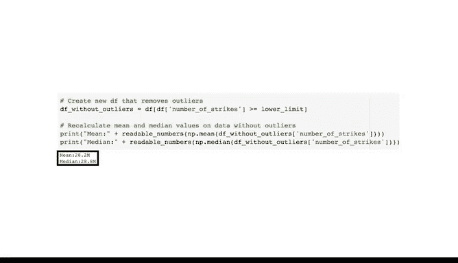

# 谷歌高阶数据分析3：《超越数字：将数据转化为洞察》go-beyond-the-numbers（中英双字） - P23：23_03_03_Python识别与处理异常值.zh_en - GPT中英字幕课程资源 - BV1Tz4y1t7PN

Earlier， you learned about three types of outliers， global， contextual and collective。

Now that we discuss outliers on a conceptual level。

 I'll show you how to identify them and analyze their impact in a Python notebook。

Our goal will be to identify outliers across a 33 year span of total lightning strike counts in the United States。

As usual， let's start by importing our libraries and packages， pandas， numi。

 Seaborn and Pipl from Matpl Live。We'll continue using our N OAA lightning strike data set。

 This time will'll group the total sum of the lightning strikes in the United States by year from 1987 to 2020。

Let's first reveal the top 10 rows of data using the head function。The data has two numeric columns。

 year， and number of strikes。As you'll notice， we're dealing with some fairly large numbers for the lightning strike totals。

It would be helpful to make them a bit shorter and easier to read in visualizations。To do that。

 let's write a readable numbers function。Below the function。

 there is a long explanatory text inside a triple set of quotation marks。

 This is called a documentation string， or dock string。

A documentation string or doc string is a line of text following a method or function that is used to explain to others using your code what this method or function does。

A dock string represents good documentation practice in Python。

It makes the code easier to understand it can be easily exported to create library documentation。

A doc string was already provided for this readable numbers function。Next。

 will form an if else statement。We want to code any number above six digits to be formatted to one decimal place。

Followed by an M。Under the L statement， we are formatting numbers with more than three digits to the same one decimal place followed by the letter K。

Under these statements， we define the new data frame we want， titled numberumber of Strs Readable。

We then use the apply function to set our readable numbers statement to only the number of strikes column in the data frame。

Using the head function we'll see the output of our newest code。

The new column has readable values of 15。6 million， 209，044。6 million in its first three rows。

 where before there were just long strings of numeric digits。

This indicates that we coded the read numbers function correctly。

Now that we have more readable values， let's plot our data。As you'll recall。

 our goal is to find any outliers among the total number of lightning strikes in 33 years of NoOAA data。

One way to find any outliers would be to investigate the mean and median of this data。

The mean is the average number of the given values。

 and the median is the middle point of the given values。When we code for these two values。

 we use the nuy functions of mean and medium。We're using the readable numbers for simplicity。

The resulting output is the mean 26。8 million and the median，28。3 million。

With the mean being 2 million strikes less than the median。

 we suspect the data distribution is likely skewed to the left。

The left side of the distribution will be a good place to investigate。

One effective way to visualize outliers is a box plot。As we discussed in a previous video。

 a box plot divides the distribution of data points into four main quadrants or quartiles。

The box plot is helpful in visualizing and confirming the outliers we've already found。

Let's plot the box plot first， and then we'll talk about it in more detail。

To design a box plot using Python， we'll use the seaborn box plot function。

We'll use the number of strikes column from our data frame as the basis for the plot。Next。

 we'll use set X tick labels based on the readable numbers statement we created already。

X tick labels simply allow us to give names to the X axis marks so that they are read more easily。

Lastly， we input the X and Y labels and the title。You'll recall that the purpose of a box plot is to show the distribution of values separated into quadrants or quartiles。

What we are most focused on with our plot are that the two points beyond the far left of the line are below 10 million。

This data visualization is showing us very clearly there are outliers included in our group of data points。

The blue rectangles in your box plot are called the inter quartile range。

This range represents the difference between the third quartile and the first quartile of a set of data values。

A standard rule statistics， which you will learn more about in another course。

 is that any data point that falls beyond 1。5 times the blue boxes are considered outliers。

This next piece of code will help us define what value is at 1。5 times below our interquartile range。

 We'll use the quantile function to define what we'll call percentile 25 and percentile 75。

We enter our data column， number of strikes for our data frame， and then 0。25 and 0。

75 in the argument fields。The values that occur between the 75th and 25th percentile are the intercorrtile range。

We create a statement for intercorrtile range， IQR。

 defining percentile 75 minus percentile 25 is equal to IQR。Now， let's define two statements。

 upper limit and lower limit。Upper limit is equal to percentile 75 plus 1。5 times IQR。

Lower limit is percentile 25 minus 1。5 times the IQR。Lastly。

 let's have Python provide the exact value of the lower limit。Will input print followed by the text。

 Lower limit is colon plus sign， readable numbers and lower limit in the argument field。

After running the cell， we learn that the lower limit is 8。6 million。

Don't worry if you're still trying to understand interquartile range。

 This concept will be explored further in depth later in the program。Next。

 let's plot the values that lie below our lower limit of 8。6 million。

Place the number of strikes column inside the brackets next to DF。

Then use the less than symbol followed by the lower limit we just arrived。

 and now here are the outliers。One great way of seeing these outliers in relation to the rest of the data points is a data visualization。

For this plot， let's do a scatter plot。You may recall that a scatter plot represents relationships between different variables with individual data points without a connecting line。

To start this scatter plot， let's first add labels to each point on the plot。

Will define them using the add labels function for x and y points。

The PLT dot text function allows us to define how we want the text of each data point to appear。

In this case， we tell the text to start 0。5 pixels to the left of the data point and to start 0。

05 pixels above the data point。We also define the number of values using our readable number statement from the beginning of the video Next。

 let's add color to the data points。Let's make the outlier points red and the other points blue。

To do that， we'll define colors by the lower limit。

For those that fall below our previously defined lower limit。

 will code that they should be R for red and everything else will code as B for blue。

Our next line of code should feel familiar。We start by configuring our visualization size。

 in this case， we code 16 and 8 inches， which are the default units for this function。

Next is our code for scatterplots。AX dot scatter。The AX refers to axis。

 which tells the notebook to plot the data on an X versus Y data graphic。Inside the argument field。

 we first input the x axis and then the y axis， which is year and number of strikes respectively。

For the rest of the parameters， we fill in the X and Y label and the title。

We finished the parameters of our scatter plot by defining the X axis tick labels and setting the rotation of the X axis ticks to a rotation of 45 degrees。

The resulting plot shows us the years 1987 and 2019 are the two values in red， are two outliers。

Now that we've narrowed our scope of the outliers to just two years， 1987 and 2019。

 we can do a little more investigating。Let's start with the 2019 lightning strike data。

If we import just the 2019 data， the first thing we'll want to do as we learn in a previous video is convert our date column to date time。

Next， we'll create some new columns in our data frame， month and month text。

You'll notice for the date we use the STR。 slicelice function to cut the month names down to just the first three letters。

Finally， we create a data frame that groups the total number of lightning strikes for each month。

The result explains why the year is an outlier。For the 2019 data set。

 only lightning strikes from the month of December have been inputted。

If you were a data professional tasked with calculating lightning strike risk。

 you would first research the NOAA documentation available to see if there's a reason given。

If you don't find anything based on your research， you would then ask the NOAA why lightning strikes haven't been recorded for the other 11 months of 2019。

When we do the same code for 1987， the resulting output is different from 2019。

We find there are lightning strikes recorded for each month in 1987。

 this difference that 2019 does not have data for all months and that 1987 does have data for all months helps us to know how to handle these two outliers。

For 2019， it would make sense to exclude it from our analysis。As for 1987。

 we recognize that it is indeed an outlier， but it should not be excluded from our analysis because it does have lightning strike totals included for each month of the year。

Now， before we end， let's return to the mean and median values that we calculated earlier。First。

 let's create a new data frame， including only data points that exclude the outliers we identified。

Our goal here is to show the mean and median of the data set excluding the outliers。To do this。

 we'll use a data frame without outliers we just created and our readable numbers statement to only include data points that are greater than our lower limit。

When we exclude those outliers， the mean and median are much closer together。

 suggesting a fairly evenly distributed data set。

Now， let's revisit the goal we set earlier to identify outliers across the 33 year span of total lightning strike counts in the United States。

We discussed a lot of new concepts and we achieve this goal。

