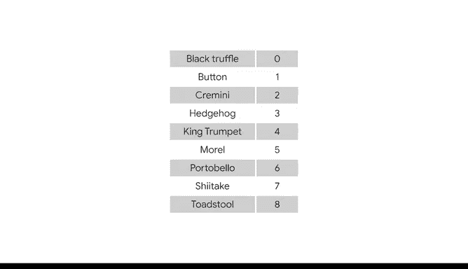

# 谷歌高阶数据分析3：《超越数字：将数据转化为洞察》go-beyond-the-numbers（中英双字） - P24：24_03_01_数字与名称排序对比.zh_en - GPT中英字幕课程资源 - BV1Tz4y1t7PN

Have you ever tried to charge your phone with the wrong type of plug， it is a frustrating problem。

 but definitely not an insurmountable one。You will probably experience a similar frustration when you work with categorical data categorical data is data that is divided into a limited number of qualitative groups。

 for example。Demographic information tends to be categorical like occupation， ethnicity。

 and educational attainment。Another way to think about categorical data is data that uses words or qualities rather than numbers as a data professional。

 you will likely work with data sets that contain categorical data。

cateategorical data entries can typically be identified quickly because they are often represented in words and have a limited number of possible values。

 Many data models and algorithms don't work as well with categorical data as they do with numerical data。

Assigning numerical representative values to categorical data is often the quickest and most effective way to learn about the distribution of categorical values in a data set。

 There are some algorithms that work well with categorical variables in word form。

 like decision trees， which you'll learn about in another course。 However， with many data sets。

 the categorical data will need to be turned into numerical data。

This conversion is often essential for predicting， classifying， forecasting。

 and more there are several ways to change categorical data to numerical in this video we will focus on two common methods。

 creating dummy variables and label encoding。😡，One way to work with categorical data is to create dummy variables to represent those categories。

 Dmmy variables are variables with values of 0 or one。

 which indicate the presence or absence of something。

 It helps to open a data with dummy variables already created to understand what their function is。

 You'll find in this data set that for any value that has been determined to be mild a1 has been input。

 All other values in the mild column are labeled with zeros。

 The same goes for other categories and values。 You can think of it as the one representing a yes and the zeros representing a no。

 dummy variables are especiallyly useful in statistical models and machine learning algorithms。

 Another way to work with categorical data is called label encoding。

 label encoding is a data transformation technique where each category is assigned a unique number instead of a qualitative value。

 for instance。Let's imagine you had a data set about mushrooms in which you wanted to understand the distribution among different types of mushrooms Imagine you've been given a data set about mushrooms with a column titled type。

And the options of black truffle， Crimini， King trumpet， button， Hedgehog， Morll， Portobello。

 Tostool or Chauttaki。You could use label encoding to transform each mushroom type into a number。

Black truffle would be changed to a zero。Button would become a one。Krimini， a two， hedgehog， a three。

King trumpet of four， Morerell，5， Portobello 6， Chaauki 7， and lastly， Tostool would be eight。

So why do data professionals use label encoding？Data is much simpler to clean。

 join and group when it is all numbers。It also takes up less storage space。

An algorithm or model typically runs smoother when we take the time to transform our categorical data into numerical data。

 for example， let's say you try to run a prediction model using the mushroom data set。

 which will try to anticipate the percent chance a new mushroom introduced to the data is a portobello。

If we try to create a model without first performing the label encoding。

 the prediction model will not function Of course there will be models and algorithms in which you may not want to perform label encoding。

 let the business need be your guide on whether or not you'll need to perform label encoding。😡。

The type of model or algorithm you choose will determine whether or not you encode labels。

 You'll learn more about algorithms and models in an upcoming course。

Much like making sure you have the right phone charger to plug into your phone as a data professional。

 you need to make sure your data is ready to use with models or algorithms。

