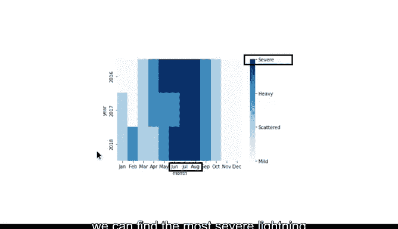

# 谷歌高阶数据分析3：《超越数字：将数据转化为洞察》go-beyond-the-numbers（中英双字） - P25：25_03_02_Python标签编码实现.zh_en - GPT中英字幕课程资源 - BV1Tz4y1t7PN

In a previous video， you learned about the importance of label encoding。

 also known as transforming categorical data into numerical data。

Now it's time to open our Python notebooks and learn how to do it。

Let's continue with the same NOAA data we've been using for lightning strike counts。

For this notebook， we'll look at data from 2016， 2017， and 2018。

Let's start by importing Python libraries and packages。For this notebook， let's import date time。

 pandas， seaborn and pie plot from matte plot Lib。As you learned previously。

 start by converting the date column into date time， which makes it easier to manipulate。Next。

 create a column called Month like we did earlier， we will use STr。

slice to cut the month names down to only the first three letters when working with this data。

 it is helpful to make sure the month names stay in chronological order。

Our next line of code then is months， which simply defines the group of months in order。

You'll find this helpful in the next line of code where we use the pandas function categorical to group the number of strikes column by the month column。

Because we have three years worth of data， let's also create a column listing the year。To do this。

 we need the column year using the date time function， S RFF time。

This function will return a string representing only the year in the original date column。

Inside the argument field， we input percent sign y。

 indicating we only want the year from the date time string。Finally。

 let's create a data frame called DF by month， which groups the number of strikes first by year and then month。

The last part of the code here is making sure that the number of strikes is added together for each month using the sum method We'll tack on the reset index function to tell the notebook to recount the rows from zero without using its initial order。

When we look at the top of the data frame using the head function。

 we get the first five rows of data with columns of year， month and number of strikes。

Let's create a column for categorical variables called strike level。In this column。

 we will group or bucket the total number of strikes into categories， mild， scattered， heavy。

 and severe。 This is how we perform label encoding in Python。To do this。

 we'll create a new column in our Df by month data frame called strike level。

 This new column will be coded using the pandas function Q cut the Q in this function refers to quantile。

 meaning that when using this pandas function， you can cut the data into four equal quantiles First parameters。

 we first input the desired column we want to cut into quantiles。

 which will be the column called number of strikes。Then we input the number of quantiles we want。

 which is 4，1 for each classification。 We type in those classifications under the label parameter。

 mild， scattered， heavy and severe。 Let's use the head function to find out how our code modified the data frame。

 D F by month。It may seem counterintuitive to create categorical data in order to then transform it to numerical data。

 but this process will allow us to segment the data into useful chunks。

 which can then be plotted on a graph in interesting ways。Not to mention。

 string categories are easier to understand in a data visualization than numbers。

One other column which will help us later， is to assign numerical values to the strike levels we just defined as mild。

 scattered， heavy and severe。 we'll call this new column strike level code we'll define it by taking the column strike level and adding dot cat dot codes。

 cat codes is appendus function that takes categories and assigns them a numeric code In this case。

 when we run the cell， we find that mild has been assigned a0 Sc assigned a one heavy a two and severe a3。

And that's how we perform label encoding。Having both the categorical terms for different levels of lightning strikes and the numeric codes to go with them。

 we can create data visualizations or models that are straightforward to interpret。

One other helpful way to work with categorical data is to create dummy variables to represent those categories。

As you'll recall from a previous video， dummy variables are variables with values of0 or one。

 which indicate the presence or absence of something。

 The pandas function will use to achieve this in our Python notebooks is called get dummies to clarify。

 new columns of ones and zeros are also known as dummies。

 The get underscore dummies function converts these categorical variables， mild， scattered。

 heavy and severe。 into numerical or dummy variables from the column called strike level。

 If we run the cell。 you'll find this function creates four new columns and puts a one in any row where the number of lightning strikes falls into the labeled category and a zero for anything else。

Now that we have our new columns of categorical data， numeric data and dummy variables。

 let's discover what you could potentially learn from these groupings。To do that。

 let's plot our data。We'll first create a data frame called D F by month plot。

 Let's reshape the data by using the pandas function。 Pivot。

 Pivo allows us to reshape our data frame into any given index or set of values we want based on the parameters inside the pivot function。

Those parameters are index， columns and values in that order。To help us with the visualization。

 let's use year in the index field， month in the columns field and strike level code in the values field。

If we use our head function， we find all three years in the rows。

 the months in the columns and the strike level categories in each month， just like we coded。Next。

 let's visualize our data using what is called a heat map。

 so we have a better idea of where most of the lightning strike values are。

A heat map is a type of data visualization that depicts the magnitude of an instance or set of values based on two colors。

It is a very valuable chart for showing the concentration of values between two different points。

Let's create a heat map using Python。Using the heat map plot from Seaborn。

 we can place DF by month plot in the parameter field for the data along with C map equals blues。

This C map definition will give us a preset color gradient from dark。Blue to white。Next。

 we fill in some of the parameters to help with understanding the visualization。In this case。

 we'll use the standard collection0 from Seaborn for our color bar。

This will just give us a preset gradient color bar which saves us a lot of time from having tocode our own colors on a color bar Next we'll set the color bar ticks to zero through three and label those ticks according to our four strike levels severe。

 heavy， scattered and mild。Lastly， when we code the show function， we are given a beautiful heat map。

 using the heat map we can find the most severe lightning strike months across all three years。

Thanks to Pandadas and Seaborn， transforming data into categories and back into numerical data is possible with just a few lines of code。

As we discussed， it's easier to plot a visualization by using strike level code as the base values。

The categories we created of mild， scattered， heavy。

 and severe became the labels on our heat map plot。Label encoding can be as simple as that。

 and it is an essential skill for data professionals。

