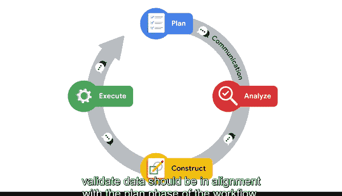

# 谷歌高阶数据分析3：《超越数字：将数据转化为洞察》go-beyond-the-numbers（中英双字） - P26：26_03_01_输入验证的价值.zh_en - GPT中英字幕课程资源 - BV1Tz4y1t7PN

When I think about input validation and the EDA practice of joining。

 I like to think about vegetables。Allow me to explain。

When you're at the market picking out leafy greens and root vegetables。

 you check that they're fresh first， right？And not just at the store。

 you also check on them at home when they're in the refrigerator。

 plus you probably ensure that they're still edible one more time before you cook and eat them。

Lastly， if for some reason the vegetables have gone bad or you didn't buy enough for a recipe。

 you would need to add more。Performing EDA on a data set is similar to checking for the freshness of vegetables。

 You are searching， exploring and checking that the data is as error free as possible。

You should check and recheck your data sets to make sure that they are correct。As I mentioned before。

 as a data professional， you should know your dataset thoroughly One way to make sure you know a dataset is validating it。

 which is， as you recall， one of the six practices of EDA there are many different ways to validate a set of data。

 but here we'll discuss input validation input validation is the practice of thoroughly analyzing and double checking to make sure data is complete。

 errorfree and high quality input validation is intended to be an iterative practice。

 meaning you should perform it again and again in between and during the other five practices of EDA。

 which are discovering， structuring， cleaning， joining， and present it。😡，Most often。

 as a data professional， you will perform input validation when starting a new analysis project or getting familiar with a new data source。

We will discuss more about the how of performing input validation later in the program。Now。

 we will focus on the why and the what。Why should we take the time to validate data？

 What exactly are we looking for When we validate data。

 we help make more accurate business decisions and we improve complex model performance。

 Think about it like this。 if a gourmet chef doesn't double check the vegetables for freshness before cooking a dish。

 The food could taste horrible or worse。 make people sick。 It is much the same with data。

 The more careful we are in checking and rechecking our data after each manipulation of the data during ED。

 the less likely we are to have problems later， clean and validated data can help prevent future system crashes。

 coding issues or wrong predictions。 So while we are performing our valid work。

 What is it that we're searching for。 No two data sets are alike。

 There will be different things to check for based on the type。

 Here are some questions to consider when validating data are all the data entries in the same form。

For example， are people's ages expressed as solitary numbers like 23 and 47 or within a range like 18 to 35 and 35 to 50 are all entries in the same range for instance。

 in finance are some of the values expressed in thousands of euros and others in millions of euros Finally。

 are the applicable data entries expressed in the same data type For example。

 are all the dated entries expressed in the same format of month， day or year。

While asking these questions or while performing EDA in general。

 you may find that the data you have been given is not sufficient to answer the business questions that you have been tasked with。

😡，For example， let's go back to the comparison we made earlier in the video to a gourmet chef and his vegetables。

Imagine that the gourmet chef is introducing a new recipe to their restaurant。

They are not sure how many vegetables will be needed for the new dish。 In the end。

 the chef realizes half way through that day that they did not account for additional vegetables to be used in vegan and vegetarian dishes。

It is at that point the chef would buy more vegetables。

The EDA practice of joining is much the same principle as you've learned。

 joining is different from the structuring technique。

 merging while asking these questions or while performing EDA in general。

 you may find that the data you have been given is not sufficient to answer the business question。

 Joining is the process of augmenting data by adding values from other data sets。

The practice of joining will be most useful if we validate the data to ensure formatting and data entries align and are the same data type。

For example， while adding the new vegetable， the chef will want to make sure the consistency and taste are similar to the vegetables that they've been using all day。

 otherwise， the dish may not turn out the same。You will need to use your own logic， common sense。

 and experiences to understand the ways in which you should join or validate each particular data set you work on。

There won't be a rigid process to show you down to the detail how to handle each data file。

Data science takes a lot of analytical thinking and shifting of perspectives to be thorough in your EDA and validation。

Experience and effort will be the best way to improve your performance in analytical thinking。

We'll also be exploring examples in our Python notebooks as well。

Keeping your validation practices in line with the pace workflow will also help you keep a focus on ethics。

Validation should be about cleaning and correcting data for the sake of quality and correctness。

You probably won't be surprised to learn that the EDA practice of validating fits squarely in the analyze phase of our pace workflow。

 but is also a practice you should use for all four phases。 Remember， pace stands for plan， analyze。

 construct and execute this means that what and how we join and invalid data should be an alignment with the plan phase of the workflow。

 For example， if your task is to discover which week within a given month is most profitable for a business。

 it will be important that you check and recheck that you have grouped the revenue dates into weeks correctly。

Your analysis won't be effective if you think you've grouped revenue by week。

 but actually done it by day or month。When you look to validate your data to this level of detail。

 it will help you toward meeting your pace goals， specifically for the construct and execute phases before we end there's one more thing that can help you with validating and joining aspects of EDA。

Look to your peers and managers to help you。 A peer reviewed data set is one of the best ways to ensure that you check yourself on bias。

 keep ethics as a focus and ensure you are on track with the pace workflow， remember。

Validating data is like checking your vegetables to find if they're the right choice for the recipe。

It may take extra time up front， but it may save you from headaches and stomach aches down the road。

