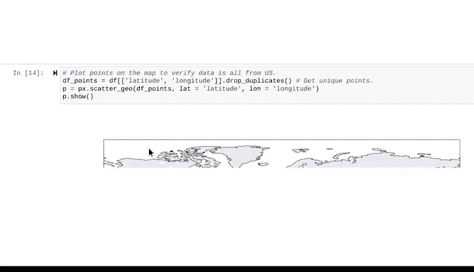

# 谷歌高阶数据分析3：《超越数字：将数据转化为洞察》go-beyond-the-numbers（中英双字） - P27：27_03_02_Python输入验证实践.zh_en - GPT中英字幕课程资源 - BV1Tz4y1t7PN

In this video， you'll perform input validation in Python。Remember。

 input validation is the practice of thoroughly analyzing and double checking to make sure data is complete。

 error free， and high quality。Just like checking your vegetables before you cook them。

With that knowledge fresh in your mind， it's time to discuss how to perform input validation in Python。

We'll focus our validation on the NoOAA data， the goal will be to check for errors and prepare this data set for publication。

Let's open our Python notebooks and get started。First step， as usual。

 we will import the Python libraries and packages that we need for input validation。

You'll notice we have pie plotot from Maplot Lib， Padas， Ply Express and Seaborn。Next。

 with our lightning strike data libraries and packages all imported in our notebook。

 let's use the head function to take a look at what we have in terms of columns and the top five rows。

You'll find our familiar lightning strike dataset set also includes a fourth and fifth column。

 longitude and latitude， respectively。If we were to check the data types now using DF dotD types。

 we would discover the date column is a string data type。As we did previously。

 let's convert the column to date time。One thing we should include in our input validation is a check for missing data。

You'll recall from earlier that we likely will have already done this check for missing entries during the cleaning part of EDA。

The definition of validate assumes an action or process has already been completed。 So if we input。

Is Nell。 sum into our notebook in order to give us missing values for the second time。

 it is a practical and not redundant thing to do。After running the code。

 we find that there are indeed no missing values。Next， for this data set。

 let's review the ranges of all the variables。In this review。

 we will check the highest and the lowest values of each column and the overall distribution of values。

To do this， we'll use theDescribe function， which you may recall from previous video。

In the argument field， we'll use the parameter includes equal all。

This will tell the notebook to include every parameter covered by the describe function。

You'll notice Nan values in some of the describe fields like unique， last， and Max。

Remember that these are not fields in the data set， but rather a summary table of attributes。

For example， you'll notice that there are Nans in the date column for mean， min， 50% and max。

These are to be expected because dates are not data types that would be averaged。Speaking of dates。

 let's double check our date column first， are there any calendar days missing？

We know from prior EDA work on this data set that the date column should include every day of each year。

Let's confirm each day is listed by designing a calendar index。 We'll call it full date range。

We'll then use the pandas date range function with the first and last dates of 2018 in the argument field under the start and end parameters。

After that， let's add full date range dot difference。

 then in the argument field we'll add DF and in the brackets， the column header date。

 which will limit this function to checking only the date column。The result is interesting。

There are four consecutive days missing in June of 2018。

Then two consecutive days in September and two consecutive days in December。

This finding would be something to investigate or to question the owner of the data to find out the reason why。

Given that the number of missing days is relatively small。

 you could complete your analysis by making a note of the missing days in the presentation。

This will ensure that anyone who analyzes your visualization or presentation will know that the data depicted doesn't include those missing dates。

Now that we've done some initial validation， let's get a better sense of the range of the total numbers of lightning strikes。

If we use a simple box plot data visualization with number of strikes as our data parameter in the argument field。

 we'll find that the distribution is very skewed。Most days of the year have less than five lightning strikes。

 but some days have more than 2000。As you recall from a previous video。

 we can remove the outliers from the box plot visualization to help us understand where the majority of our data is distributed。

We can do that by adding show flyers equals false into the argument field。

The result is much easier to interpret。From what we know of lightning strikes in the North America regions of the United States。

 Mexico， and the Caribbean。This distribution is conceivable。

If the highest distribution of strikes were all in the 2000s， we might be a little more skeptical。

The last bit of input validation we will do is to verify that all of the latitudes and longitudes included in this data set are in the United States。

This will ensure we don't have any mistakes in our geographic values。To do that。

 we'll first create a new data frame that removes all the duplicate values。

 We'll type Df underscore points equals Df， then latitude and longitude in double brackets。

Following that， we'll add dot， drop， underscore duplicates。

The reason we want to drop duplicate points for the latitude and longitude is that we don't need to check a particular location on a map twice。

After running that code， we have a new data frame that only includes two columns。

 latitude and longitude。Within those two columns， we find that there are no duplicate data points。

Finally， we will plot these points on a map。Here's a tip。

When you're working with hundreds of thousands of data points plotted on a map。

 it takes a lot of computing power。To make it a shorter run time。

 we'll use the plotly express package。The package is designed to keep run times as low as possible。

To plot these latitude and longitude points on a map， we use the scatter Geplot from Ply Express。

Within the argument field， we'll fill in the proper parameters for a scattered geoplot。In this case。

 we'll first input the data frame name D F points followed by first LAT T for latitude。

 then LON for longitude。And the last code is to show the scatter plot。After running the cell。

 you'll notice the runtime is still slow because of the sheer volume of the data。

Most data professionals use input validation regularly。

 so these are important concepts to learn and important technical skills to practice。

