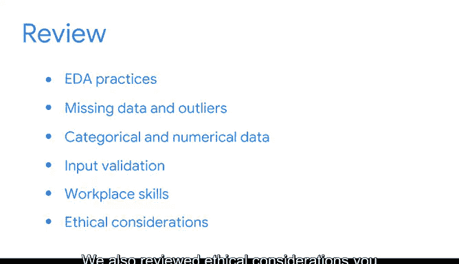

# 谷歌高阶数据分析3：《超越数字：将数据转化为洞察》go-beyond-the-numbers（中英双字） - P28：28_03_01_总结回顾_3.zh_en - GPT中英字幕课程资源 - BV1Tz4y1t7PN

As you learn， data set can be busy and chaotic。 There are many different things happening in them。

 It can be difficult to figure out where to focus and how to uncover those stories buried beneath the surface。

 In this section of the course， you learned some important strategies to help you correct mistakes and discover hidden data stories。

 We focused our story， finding efforts by learning the Eda practices of cleaning， Jo and validating。

 We discussed a lot of ways to engage in those practices。

 We focused on working with missing values and outliers。

 transforming categorical into numerical data and input validation。😊。

And we reminded ourselves not to forget to visualize our data in Python to help further our understanding。

 We discussed identifying missing data and outliers in Python and why it's important。

 both from an ethical perspective and a business sense to find them。

 We considered the difference between categorical and numerical data and why transformation using Python is important。

 As for input validation， you learned what it is why it's important and how to perform it using Python。

 We also discussed some works skills along the way。

 such as understanding when to communicate with stakeholders or other subject matter experts about missing values。

 We also reviewed ethical considerations you should make when performing cleaning。

 Jo and validating work。 You learned why these practices are vital when performing E D on a data set as part of the pace。

 workflow。 E D can be an exciting process。😊。

Throw EDA not only saves time and energy on future processes， but it also helps you find the trends。

 patterns， and stories in the data。Later， you'll learn how to use Tableau to design and present data visualizations to key stakeholders and business managers in a business setting。

 In the meantime， you've learned some amazing skills that data professionals use almost every day。

The ability to perform careful EDA on a data set in Python is an essential building block in a data professional's career。

Great job on your work， so far。

