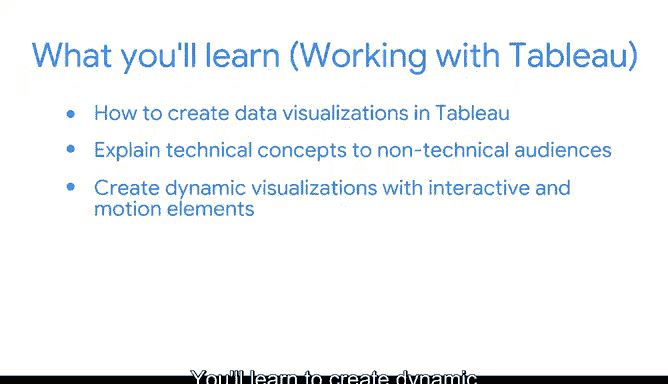

# 谷歌高阶数据分析3：《超越数字：将数据转化为洞察》go-beyond-the-numbers（中英双字） - P29：29_04_01_欢迎来到模块4.zh_en - GPT中英字幕课程资源 - BV1Tz4y1t7PN

We've reached the final practice of EDA presenting as we discuss visualizing and presenting don't necessarily come at the end of your data exploration。

 you may create visuals of your own data throughout the data analysis process The practice of visualizing your data will help you discover insights and further your own understanding The presenting practice of EDA is an important part of both the analyze and executing phases of the pace framework Sometimes you'll create visualizations to analyze the data during the analyze phase at other times you'll utilize data visualizations as part of executing an algorithm。

😡，In this video， we will focus on designing data visualizations for the purpose of presenting In this course。

 we'll discuss concepts such as accessibility， tableau basics， dashboards and data visualizations。

You may recall some of these concepts from the Google data Analytic certificate。 if you'd like。

 take a few minutes to review that content before moving ahead Com up。

 you will learn how to improve your data visualization skills。

 The accurate representation of data is one of the most important aspects of a successful presentation。

 You'll learn specific techniques for making data visualizations that represent the data with precision。

 Another aspect of designing successful data visualizations is ensuring they are inclusive。

 We will talk about tips and techniques for making your data visualizations accessible to a diverse audience。

 You will also learn about the data visualization platform Tableau Tableau is a versatile data visualization software primarily use for presenting data to inform and improve businesses using the software you'll learn how to create data visualizations that tell stories and explain technical concepts to non-technical audiences Youll learn to create。

Dynamic visualizations with interactive and motion elements and to alter visualizations based on different audiences needs。

We will also discuss how to choose the right graphic or chart， give context during presentations。

 and select the proper order and timing for your data visualizations while presenting。😡。

Data professionals often need to create data visualizations and deliver presentations。

That's why we'll discuss the most important skills to help you thrive in this area。After all。

 you want your audience to understand your data story as a data professional。

 you will have an opportunity to tell data driven stories that change your team， department， company。

 industry， or even the world。😡，Now let's get started。

